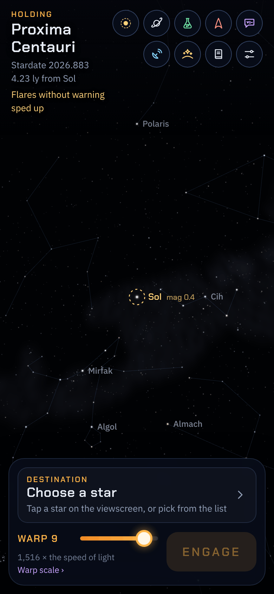
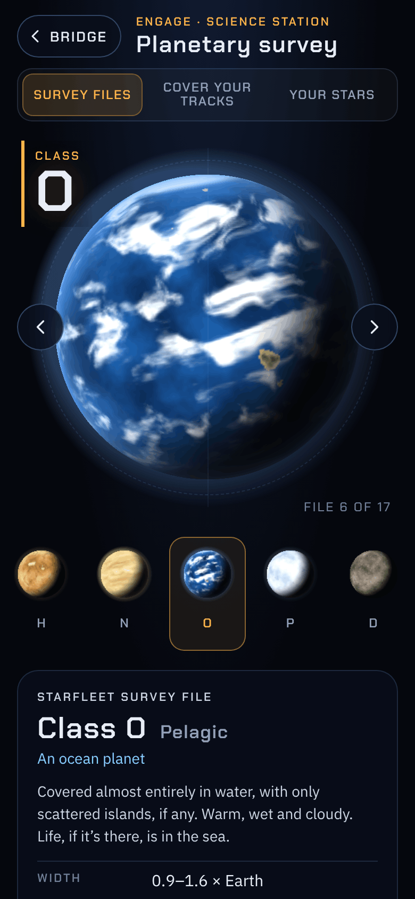
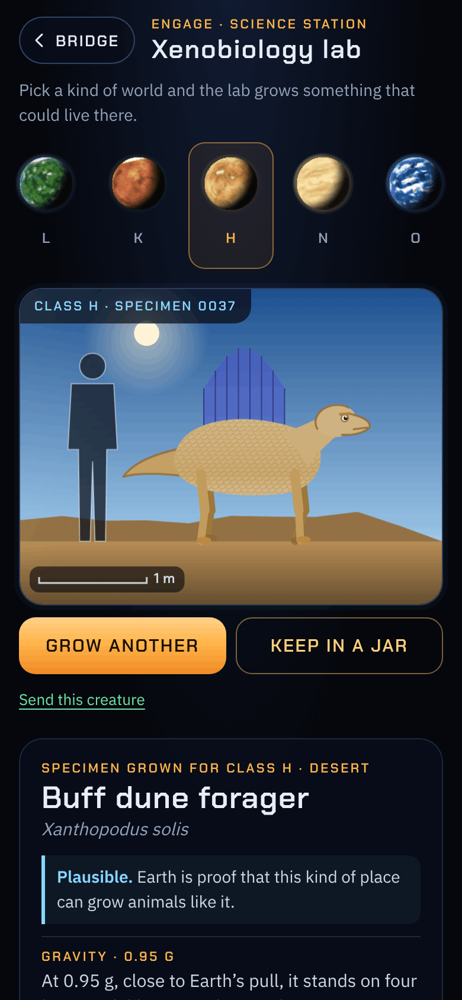
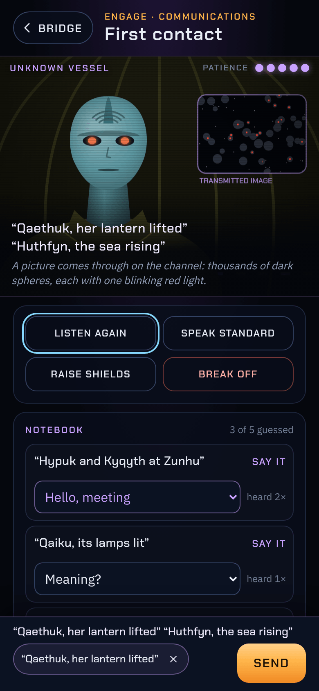
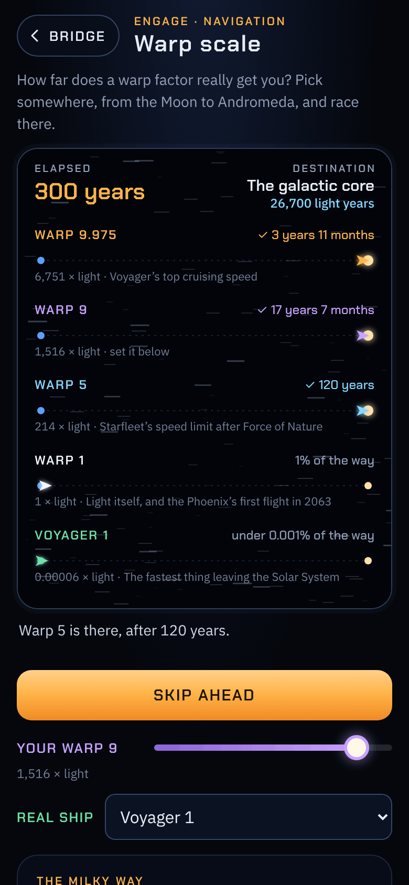
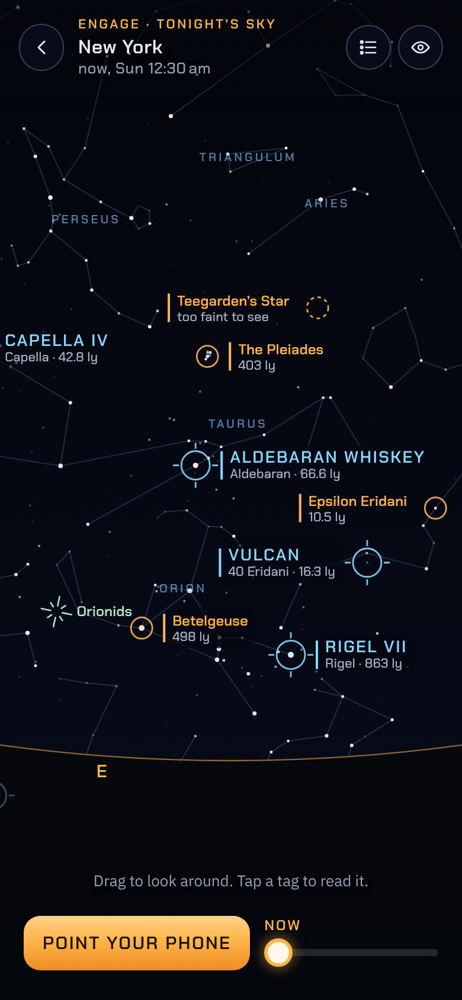

# Engage

**Use it: [engage.junkdrawer.works](https://engage.junkdrawer.works/)**

**Take the helm of a starship and warp to real stars.** Pick a destination, set a warp factor, and engage. The sky on the viewscreen is drawn from a real star catalogue, so as you travel, nearby stars slide past and constellations come apart the way they really would. When you drop out of warp, the captain’s log tells you what you’ve found, including where our Sun now sits in that sky.

<p align="center">
  
  &nbsp;
  
  &nbsp;
  
  &nbsp;
  
  &nbsp;
  
  &nbsp;
  
  &nbsp;
  
  &nbsp;
  
  &nbsp;
  
  &nbsp;
  
  &nbsp;
  
</p>

## How it works

- **Every star is real.** About 18,000 of them, from the HYG database: everything you can see from Earth with your eyes, plus every catalogued star within 80 light years. Each is drawn at its true position and as bright as it would look from wherever the ship is. Far from home the viewscreen thins out, because a star’s faint neighbours out there aren’t in the catalogue; the log says so once the ship is more than 250 light years out.
- **Set course.** Tap a star on the viewscreen, or choose from 32 destinations with notes (Proxima Centauri, TRAPPIST-1, Vulcan’s sun 40 Eridani, Betelgeuse…) or search the whole catalogue. Away from home, under the voyages, it lists the five stars nearest the ship. Type a year, such as 1987, and it also lists the three brightest stars that year’s light from Earth is reaching about now. The same box is the ship’s computer: ask it “nearest”, “nearest with planets”, “brightest from here”, “within 20 ly”, “red giants” (or any colour and size, “white dwarfs”, “carbon stars”), “unvisited” or “how far is Vega”, and it answers in a line, measured from wherever the ship is, with the stars to tap under it. The search knows where Starfleet’s charts put things too, at 28 real stars: Vulcan, Farpoint, Tellar, Rigel VII, Mintaka III, Regulus V, Gamma Hydra IV, Garth of Izar.
- **Voyages.** At the top of Set course, five named routes through the destinations with notes: the neighbours (and home), Starfleet’s atlas, the planet hunt, the winter sky taken apart, and the brightest seven. Each shows its stops, how far they add up to from where the ship is, and how long that is at the helm’s warp. Take one and the helm is set for its first stop; each arrival on it says in the log which leg it was (“Leg 2 of 7 of The neighbours”), and the main button under the log names the next leg and sets course for it. A detour leaves the voyage waiting; the last leg ticks it off.
- **Warp factor.** Warp 1 is light speed and warp 9 is about 1,516 times it. The helm shows how long the trip would take, next to how long light needs. The flight itself is shortened to a few seconds.
- **Drop out of warp.** The ship holds where the star’s disc looks about two and a half degrees wide, or in the orbit of a known planet. Under the star’s name, one line says what the arrival did: a first visit, the farthest yet from Sol, the longest trip yet, another destination charted. The log covers the star (for a giant, how far it would reach in the Sun’s place: Betelgeuse past the orbit of Mars), where a planet would get the sunlight Earth does and how big the star would look from there, for one of the five stars that behave (Algol, Mira, Delta Cephei, Betelgeuse and Proxima Centauri) where it is in its cycle as Earth sees it (“Right now”: shining at its usual magnitude 2.1, and when the next eclipse is deepest), and for an ordinary star with no notes a rough mass, how long it shines and how it ends (“about twice the Sun’s mass, good for about 2 billion years”), all worked out from the catalogue and said with an “about”; then its planets, a few notes, what Starfleet’s charts put there, the brightest star in that sky and the nearest one (with a button to set course for it), how the Sun looks from there, which year of Earth’s history its light is showing and what happened in it (“Earth as it was in 2018, the year Voyager 2 left the Sun’s bubble for interstellar space”, with a link to that ship in long missions), and when Earth’s first TV broadcasts arrive.
- **The captain’s log** keeps every arrival, under a heading for its day (“Wednesday 18 November · 6 arrivals”), with the time it was made beside its stardate. Between the arrivals, the other rooms each add a line when something there finishes, by when it happened: “Supplemental: sat the Kobayashi Maru. The lifeboat, 150 home, C B B B.” There is one for each simulation and for passing the Bridge Officer’s Test, each first or second contact, each creature kept in a jar, the latest best streak in Cover your tracks and the latest hail to each ship on a long mission, and each leads to what it is about. It opens on the newest 50, and **Show earlier** adds 50 more. Past 30 entries it has a search box (a star’s name, or anything an entry says) and **By star**: one row for each star, the most recently visited first, with how many visits and when, opening on the newest entry for it. **Print the log** lays the whole log out as a booklet, oldest first, black on white, one entry to a block; on a phone that is also how to save it as a PDF. At its head, one sentence sums the voyage up from every room’s record: “Fourteen months out: nine stars, one new species, one failed exam.” Under it, the **service record** reads every room’s record and shows the career in one card, each row leading to its room: the Kobayashi Maru’s endings seen and best grades (and the Bridge Officer’s Test, once passed), the peoples met and contacts made, the best streak in Cover your tracks, the creatures in jars and the ships hailed, or what each room is still waiting for. Then come a few records worked out from the log: the farthest you’ve been from Sol, your longest trip, the star you’ve visited most, how many of the 32 destinations you’ve reached, and which kinds of star you’ve been to (the classes O B A F G K M light up as you visit one of each, and a red supergiant, white dwarf, carbon star or Wolf-Rayet star is named once you’ve seen one). Open an entry to **Set course again** for its star, to find it **In your sky tonight**, or to **Share this course**: a link that sets the same course on someone else’s bridge. For the 31 destinations with notes (all but home) the link is a page of the star’s own, such as `engage.junkdrawer.works/course/vega.html`, so it previews in a chat as that star (“Set course for Vega”, Starfleet’s story or a line from its notes, and the star as the viewscreen shows it on arrival, with “25 light years · the Vega colony”) and passes straight on to the bridge; any other star’s link is `engage.junkdrawer.works/?course=Alpheratz`. Both kinds of link will keep working. On a first visit the welcome card then opens with the course it brought: “A course is laid in for Vega, 25 light years out. Take the helm and engage.”
- **The rooms off the bridge.** The welcome card lists the seven rooms, each with the picture on its round button and a line on what it is, and each a link; Bridge settings keeps the same list, and **Show the welcome again** brings the card back. The round buttons are drawn small, but each can be tapped anywhere in a 44-pixel square round it.
- **The five-year mission**, a switch in Bridge settings that starts off. Each arrival adds the trip’s time at warp to a running total, so a slow warp factor costs something: the header shows “Year 2, day 114 of 5” where the stardate was, and the helm says where a trip would leave the mission (from Earth, Betelgeuse at warp 6 is 15 months of it; at warp 9.9, about two months). The arrival that reaches five years closes the mission, says so, and leaves a summary in the log over that arrival (its stars, light years, ship time, dates and records, and what the other rooms logged while it lasted); the next trip starts the next mission. With it on, the log’s sentence is the mission’s (“Year 2, day 114: nine stars, one new species, one failed exam.”) and the service record opens with the clock. Nothing is deleted, and switching it off puts everything back as it was: the clock is worked out from the log, which keeps each trip’s warp factor for it.
- **Your ship.** Bridge settings can give her a name and a registry (“Calypso”, “NCC-74210”), and the rooms that speak of her use them: the Kobayashi Maru’s briefing (“You command the USS Calypso”), first contact (“off the Calypso’s bow”), the captain’s log and its service record, and your lane on the warp scale. A name typed with a prefix of its own (SS Botany Bay) keeps it; any other is the USS. Unnamed, she is spoken of as before.
- **Look for the Sun.** The ☉ button turns the view toward home, marked even when it’s too faint to see.
- **Autopilot**, in Bridge settings (or F at a keyboard): the helm and the round buttons go, the screen goes full and stays awake, and the ship flies itself. A voyage under way flies its next leg; otherwise it goes to the nearest destination with notes not yet in the log, then the brightest named stars, and once it has been everywhere, wherever it was longest ago. At each star it holds about 20 seconds with two lines on screen, its name and what it is, then goes on. Every stop goes in the log. Any key or touch takes the helm back, and does nothing else (a flight under way finishes first). With reduced motion asked for, each flight is the usual cross-fade.
- **Earth’s sky, held to compare.** Away from the Sun, press and hold **Earth’s sky** beside the log entry’s date: the viewscreen fades to the same direction as seen from home, the constellation lines back in the shapes everyone knows and the star you’re at ringed among them (“Betelgeuse, you are here”, at Orion’s shoulder). Let go and it fades back to the sky from where you are. Space or Enter holds it too.
- **Drag to look around, pinch or scroll to zoom.** With a keyboard, the arrow keys look around, + and − zoom, and / opens Set course, where the up and down arrows move through the list and Enter takes a star. Where you were looking and how far you had zoomed are kept. Follow a link out of a log entry to another room and come back, and the entry is open again where you left it. Back, or a phone’s back gesture, closes the sheet that’s up (Set course, the log, settings, a new log entry) instead of leaving the page, and on a phone a sheet can be dragged down by its head to close it; tonight’s sky’s list, places and star cards work the same way.
- **The planetary survey** ([survey.html](https://engage.junkdrawer.works/survey.html), the ringed planet on the bridge) flips through Starfleet’s planet classes, from Class M to Demon class, next to the kinds astronomers have really found that Starfleet never named: super-Earths, sub-Neptunes, lava worlds, hot Jupiters and ice giants. Each file has typical readings, the Solar System’s examples, and real planets that fit, with **Set course** to fly there and **In your sky tonight** to find its star, and **Share this file** sends a link to it. The log links back to the files for the planets it mentions. **Cover your tracks** shows an unlogged world’s sensor readings and asks which file it would pass for, and says so when you beat your best streak.
- **The xenobiology lab** ([xeno.html](https://engage.junkdrawer.works/xeno.html), the green flask on the bridge, or **Grow a creature** on any survey file) grows a creature for whichever planet class you pick, drawn in its home next to a person or a scale bar. The world decides the body: stronger gravity means more, thicker legs and a smaller animal; thick air and gentle gravity grow wings; a red dwarf’s dim light means huge eyes and near-black skin; no light means no eyes at all; heat grows a radiator sail, cold grows fur; above about 180 °C the lab gives up on water and guesses at a body of rock, like the Horta. Four field notes explain each choice, and a line says how seriously to take it. Gas giants grow drifting gas bags, ocean worlds grow swimmers, Class L grows plants (it has no animals), and every creature has a name put together from what is true of it (its colour, coat, eyes, size and build, and where it lives), a Latin one to go with it, and a link that brings it back: **Send this creature** shares it. Star Trek species and real Earth life sit alongside as reference specimens, and **Keep in a jar** saves the ones you like. The lab only ever rolls specimen numbers 1 to 9,999, so it can grow exactly 169,983 creatures, and every one has been counted: a card says when its body plan is rare for its class (“Uncommon: 171 of Class M’s 9,999 specimens fly”, and for specimen 1218, “One of a kind: the only Class H specimen that flies”), and **Lab records** links to the six record-holders, from a gas bag a kilometre across to a crawler half a millimetre long. Six real planets have a button of their own on their survey files and in the log, such as **Grow a creature for Proxima b**: the lab then uses the planet’s own measured mass, width, temperature and star (a width nobody has measured is worked out “if it is rock”), and a fifth note says what is really known about it. Their links read `xeno.html#world=Proxima%20b-42`, beside `xeno.html#M-42` for a class.
- **The Kobayashi Maru** ([maru.html](https://engage.junkdrawer.works/maru.html), the Starfleet delta on the bridge) is the Academy’s no-win test. The fuel carrier *Kobayashi Maru* is adrift inside the Klingon Neutral Zone with 381 aboard. Give one order a turn: hail, cross the line, beam survivors over (your shields drop while the transporter runs), fire, evade, go to warp, offer surrender or abandon ship. The simulation is rigged the way the Academy rigs it: the Maru is always lost and the cruisers keep coming. The briefing says where the film puts her, Gamma Hydra, Section 10, and links to the real Gamma Hydrae in tonight’s sky and at the helm. At the end the examiners grade how you lost on compassion, judgment, restraint and nerve, and say what cost you any grade below an A; Judgment never goes above a B, and the evaluation says so when you reach it. Hailing the Klingons buys one quiet turn, and it is really free: their fire, their attack on the Maru and their reinforcements don't count it. Under the verdict, the examiners' archive says how rare your ending is: how often the simulator ends that way when it is given orders at random (“About 1 in 14 ends this way”), and a run that brings 150 home is told nobody has brought more. The evaluation says what the run added to your record: an ending you hadn’t seen (“New ending · 2 of 9 seen”) and any grade that beat your best. Your record stays on the briefing: which of the nine endings you’ve seen (the rest stay unnamed), your best grade in each, and your latest runs. Come back and the examiners open the briefing with a line for you (“Third attempt. The board notes your persistence.”). **Today’s simulation** throws the same dice for every cadet that day; once you’ve taken it, the briefing keeps the line to send (“Kobayashi Maru, 18 Nov: The lifeboat, 150 home, C B B B”). **Share this run** sends that line with a link (`maru.html#run=…`) that plays your run back, turn by turn, for whoever opens it, then shows them your evaluation and offers them the same simulation with the same dice; nothing goes on their record. After your first run you can reprogram the simulator, as one cadet did. A simulation you leave part-way is kept, and the briefing offers to resume it. A second test waits under the briefing: **the Bridge Officer’s Test**, after *The Next Generation*’s “Thine Own Self” (season 7, episode 16): a damaged ship, six minutes to a warp core breach, and seven sensible things to try that don’t work. The one that does is to order the chief engineer into a flooded compartment he won’t come out of; the board’s verdict says what the other orders were for, and the briefing keeps whether you’ve passed. **One-switch play**, a box on the briefing of the Maru and of first contact (and remembered for both), steps a highlight through the choices on screen every second and a half; one press of any key or switch, or a tap anywhere, picks it, so a whole run and its evaluation take one button.
- **First contact** ([contact.html](https://engage.junkdrawer.works/contact.html), the speech bubble on the bridge) is a ship nobody has seen before, hailing you. The universal translator has their words but not their meaning: like the Tamarians in *Darmok*, they speak in images from their own stories (“Kesh and Ravu at Tavar”, “Mirel, her hands open”). Each phrase they use goes into a notebook, where you write down what you think it means from when they say it and what they’re doing at the time. You answer by choosing up to three of their own phrases. On a phone, your reply and Send stay at the foot of the screen while the encounter lasts, under their latest words, so a phrase far down the notebook can be sent without scrolling back up. Get it right and they go on: a greeting, a warning about what’s coming (an ion storm, a creature that feeds on shields, or an old minefield), a request to cross it together, a gift, when to wait and when to go. Their own words said straight back answer a greeting or a warning, as Picard’s did, but not a question: asked to cross with them, take their gift or go, the captain only asks again. Get it wrong and their patience wears thin. Raising your shields costs some too, and anything about weapons costs double. **Listen again** has them put it another way, and **Speak Standard** shows you how they say they don’t understand. Every encounter is a new language, made up from a seed: new sounds, new heroes and places, new images, and a new face on the viewscreen. The debrief shows what every phrase really meant against your guesses and translates the whole conversation, and if it goes well, they make up a new phrase about the day they met you. It also says how rare the ending is: answered with phrases picked at random, about 1 encounter in 26 makes first contact. The debrief says when the notebook was your best yet and counts each first contact as you make it, and the briefing keeps your record: species met, contacts made, and your best notebook. **Today’s hail** is the same ship, in the same language, for every officer that day; once you’ve answered it, the briefing keeps the line to send (“First contact, 19 Nov: the Qaethuk. First contact, 9 of 11 phrases decoded”), and its link plays your encounter back with your notebook, so two people can compare notes on the same aliens. Under the briefing, **Linguist’s challenges** are five named hails in the hardest languages the translator makes: each has seven “false friends”, pairs of phrases that end in the same image and mean different things (“the gates open” for hello, “the road open” for go), the most a language can have; of 200,000 languages, 38% have none and about 1 in 350 has seven. Each is marked once contact is made, with your best notebook, and **Send** shares a link (`contact.html#hail=…`) that opens the briefing on that hail. **Share this encounter** sends a link (`contact.html#run=…`) that plays the encounter back for a friend, with your notebook’s guesses, then shows them your debrief and offers them the same hail, in the same language. The hail comes in wherever the bridge left your ship: the briefing says she has dropped out of warp “here at Vega” (or in Earth orbit), and the record keeps the star. After a first contact, the captain’s log entry for that stay and tonight’s card for that star say so (“First contact was made here with the Qaethuk, stardate 2026.880”), and the debrief links to the xenobiology lab: **What might live on their world**. From the second ship on, the briefing opens by saying which ship this is and who the last were. An encounter you leave part-way is kept too, notebook and all, to resume. **Second contact**: a people you made first contact with hails again from the briefing (“The Qaethuk are hailing again”), once each, in the same language, with your notebook from that day open. This time their ship is crippled by another of the three dangers, and none of the six moments is answered with their own words: they ask whether it’s really you, need help, ask whether you fired on them (“yes” is a confession), offer you a crystal for your trouble (they want “no, together”; either half alone makes the captain wait for the rest, and costs patience), want to run before their engines are ready (“yes” sends them off too soon) and invite you home. It goes on the record as an encounter but not as a species met, the log and tonight’s sky tell where it was made, and a shared second contact (`contact.html#run=2.…`) plays back for a friend, who is then offered the same people’s first hail.
- **The warp scale** ([warp.html](https://engage.junkdrawer.works/warp.html), **Warp scale** under the warp slider) shows how far a warp factor really gets you. Pick a place on the ladder, from the Moon and the Sun through Voyager 1, Proxima Centauri, Vulcan’s sun and Deneb to the galactic core, the far side of the galaxy where Voyager was stranded, and Andromeda. With a star chosen at the helm, the link opens on a race to that star, as a rung of its own called **Your course**. Five ships leave Earth together: warp 9.975 (Voyager’s top speed), your own warp factor (it starts at the helm’s), warp 5, warp 1, which is light, and the real Voyager 1. The race clock speeds up as they go, so you see even the slowest arrive: about four years to the galactic core at warp 9.975, 27,000 for light and 473 million for Voyager 1. Each place has a note on what’s there and where Star Trek has been, when you’d arrive, and when the light you see from it set off. The Solar System’s distances are worked out for today. A place leads on to the rooms that know it: a star to the helm and to tonight’s sky, Voyager 1 to her file in long missions, Pluto to New Horizons’. **Share this race** sends a link to the place with your warp factor in it (`warp.html?warp=9.9#vega`), and the address bar always reads the same.
- **Impulse power**, further down the warp scale’s page, is what the real sky does to a ship that really moves through space. A throttle runs from a full stop to 0.999 of light speed, and the whole sky round the ship is drawn with dead ahead in the middle and dead behind round the rim, heading for the star on the card. As it opens, the stars crowd toward dead ahead (at nine tenths of light speed the forward half of the sky is squeezed within 26° of it), turn bluer in front and redder behind, and the ship’s clock falls behind Earth’s (an hour aboard is 2 hours 18 minutes at home). This is special relativity: aberration, the Doppler shift and time dilation, worked out in `js/impulse.js`. A card says why warp shows none of it: a warp bubble moves space with the ship standing still inside.
- **Long missions** ([missions.html](https://engage.junkdrawer.works/missions.html), the dish on the bridge) tracks the real ships on the longest missions: Voyager 1 and 2, New Horizons, the James Webb Space Telescope, and the silent Pioneer 10 and 11. Their positions are worked out for this moment from NASA JPL Horizons trajectories, so the distances tick up as you watch. Each file has how far she is from the Sun and from Earth, her speed, how long a signal takes, her next round-number milestone and any light-day mark she has just passed (Voyager 1 went by one light-day from Earth on 18 November 2026), the mission so far, what she’s doing now and where she’s bound, with **Set course** for the star she’ll pass, and from Voyager 1’s a race to her on the warp scale. **Hail her** sends a message at the speed of light and shows when it arrives and when an answer could get back; it remembers the hail, so you can come back tomorrow to see it land. Webb gets a near-Earth view of her loop around L2. **Share her file** sends a link to the ship, with how far she is and how long a signal takes right now.
- **Tonight’s sky** ([tonight.html](https://engage.junkdrawer.works/tonight.html), the horizon on the bridge) shows the real sky from where you’re standing, with the 28 stars Starfleet knows tagged on it: Vulcan at 40 Eridani, Farpoint at Deneb, Rigel VII, the Vega colony, Wolf 359, Mintaka III in Orion’s Belt, Merak II and Mizar II in the Big Dipper, Regulus V and more, plus every other star Engage has notes on. **Point your phone** and it follows your compass and tilt, so you can hold it up to the real sky (the screen stays awake while you do); drag sideways if the compass is a little off. Without sensors, drag to look around. A star that is up and bright enough for your sky (city, suburbs or dark) gets its whole tag; one that is too faint or below the horizon is a quiet dashed ring you can still tap, and the list says which, and the Moon and naked-eye planets are drawn too. The constellations’ stick figures are named in small capitals once it’s dark and the view is wide enough to take them in, and a star’s card says which one it is in. Tap a tag for the story, where to look and how old its light is (and for Algol, Mira, Delta Cephei, Betelgeuse and Proxima, where it is in its cycle tonight, with the time of Algol’s next eclipse), then **Set course** to fly there, or **Share this star** to send a link that opens its card in someone else’s sky. A card leads on, too: a star on the warp scale’s ladder to its race, the Moon, Mars and Jupiter to how long they’d take at warp 9, and the Moon and each planet to the survey file it is the Solar System’s example of. Stars you’ve flown to on the bridge carry a small Starfleet delta, their cards say on which stardate you dropped out of warp there, and any other star in your log gets a tag of its own. The time slider runs to 12 hours ahead, and in daylight it offers the evening. The list of stars opens with tonight’s plan in three lines: when it’s dark and what the Moon does, the best time to look (when the most of Starfleet’s stars are well up and bright enough, with a button that moves the time slider there), and any of the year’s eight main meteor showers that is active, with the point its meteors come from marked on the sky. It uses your location only if you share it, rounded to about 10 km and kept on your phone; otherwise it guesses from your time zone or you pick a city. Night vision turns everything red to keep your eyes dark-adapted, and the bridge wears it too: **Set course** on a star’s card opens a red bridge, with its big buttons drawn as outlines and the flash of going to warp kept faint. Bridge settings has the same switch.
- The tab is named after what’s on screen (the star you’re holding at, the creature in the tank, the ship, the survey file, the race, the star’s card), so history and bookmarks say which.
- No account and no server. The log and where you are stay in your browser. It works offline and installs to a phone’s home screen. Bridge settings says so under **On this device**: “Kept on this device: all eight rooms work with no signal” once the copy is whole (a count of files while it fills), an **Install Engage** button where the browser offers one, on an iPhone or iPad the way to do it (Share, then Add to Home Screen) and, in Safari, why: Safari deletes a site’s saved data after seven days of use without a visit, but not an app’s on the Home Screen ([WebKit, 24 March 2020](https://webkit.org/blog/10218/full-third-party-cookie-blocking-and-more/)). After the first log entry or jar, Engage asks the browser once to keep its storage, and settings says when it has agreed. Android’s install sheet shows five of the pictures above. **Ship’s records**, at the foot of Bridge settings, keeps all of it safe: **Save a copy** downloads one dated file of everything Engage keeps (`engage-records-2026-11-19.json`), and **Restore from a copy** reads one back on any phone or browser, says what is in it (“212 log entries, 14 creatures in jars, 9 simulations”) and offers **Add to what’s here** (logs, runs, encounters, jars and hails put together without doubles; settings stay as they are here) or **Replace what’s here**, each asked twice on the button. On Android, a long press on its icon goes straight to tonight’s sky, the Kobayashi Maru, first contact or long missions, each with the picture from its round button.

## Running it

It’s a static site: plain HTML, CSS and JavaScript, with no build step.

```sh
npx serve .                   # or any static file server, then open the printed address
npm test                      # checks the numbers, the star search, the Kobayashi Maru's rules, the xenobiology lab's rules, first contact's language and rules, the warp scale's numbers, the ships' positions and the sky overlay's astronomy, builds the single-file copies and opens each, then flies it in Chromium through the real page (needs Playwright)
npm install                   # once, for the screenshots: upng-js saves them with a 256-colour palette
node tools/screenshots.mjs    # redraws docs/*.png, og.png, og-survey.png, og-maru.png, og-missions.png, og-tonight.png, og-xeno.png, og-contact.png, og-warp.png and the shared courses' course/*.png (add `bridge`, `survey`, `maru`, `missions`, `tonight`, `xeno`, `contact`, `warp` or `courses` for only that one's)
node tools/course-pages.mjs   # after changing a destination's title, its notes or Starfleet's line for it: rewrites course/*.html (then `node tools/screenshots.mjs courses` for their pictures)
node tools/build-artifact.mjs # single-file copies for the Artifact viewer, in dist/ (or in a folder you name)
node tools/archive.mjs        # after any change to the Kobayashi Maru's or first contact's rules: runs their trials with orders at random again and rewrites js/archive.js (the tests fail until it is run)
node tools/xeno-census.mjs    # after any change to how creatures are grown: counts all 169,983 and rewrites the census in js/xeno-gen.js
node tools/make-icons.mjs     # redraws the PNG icons from icon.svg, tools/icon-full-bleed.svg (iOS) and tools/icon-maskable.svg (Android, drawn inside the circle it may be cut to), and each home-screen shortcut's icon (img/shortcut-*.png) from its room's picture in js/rooms.js
python3 tools/build-data.py HYG_CSV D3_CELESTIAL_DATA   # rebuilds data/ and img/milkyway.png (see the script)
```

To put it online with GitHub Pages: **Settings → Pages → Build and deployment → Deploy from a branch**, then pick `main` and `/ (root)`. The `CNAME` file puts it at its own address, engage.junkdrawer.works, which needs a DNS record (type CNAME, name `engage`, target `markjf99702.github.io`, not proxied) and then **Enforce HTTPS** ticked in the Pages settings. Links to the old address, junkdrawer.works/engage/, are forwarded there by GitHub with the rest of the link kept, so `junkdrawer.works/engage/?course=Vega` still sets the course.

### Ship’s records: the file

Save a copy writes one JSON file, and every file in this format will keep restoring:

```json
{ "format": "Engage ship’s records", "version": 1, "saved": "2026-11-19T12:00:00.000Z",
  "keys": { "engage.v1": { "log": [], "ly": 0 }, "engage.maru.v1": { "runs": [] }, "engage.oneswitch": "on" } }
```

`keys` holds each of Engage’s keys in the browser’s storage (they all start `engage.`) with what Engage keeps under it, as JSON, or as plain text for the keys that keep text. A later Engage that keeps more adds keys; the version goes up only for a change an older copy of Engage couldn’t read, and a copy saved by a newer Engage is refused with a line saying to reload.

### Files

- `js/app.js`: the bridge: helm, flight, looking around, the log and settings.
- `js/sky.js`: the viewscreen in WebGL: stars, constellation lines, the Milky Way, star discs and warp streaks.
- `js/physics.js`: warp speeds, brightness, colour and size of stars, trip times, and how heavy a planet of a given width is (and how wide one of a given mass). Pure functions.
- `js/logbook.js`: the captain’s log, long: each arrival under its day, the newest 50 at a time, a row for each star, and the search. Pure, checked by `test/voyage.test.mjs`.
- `js/records.js`: ship’s records: the file of everything Engage keeps, read back, and put together with what is here or in its place. Pure, checked by `test/voyage.test.mjs`.
- `js/myship.js`: your ship’s name and registry, as the rooms speak of her. Pure but for reading the bridge’s save, checked by `test/voyage.test.mjs`.
- `js/voyage.js`: the captain’s log as one voyage across the rooms: the supplemental lines each room adds, read from its own record, the voyage in one sentence, the service record, and the five-year mission’s clock. Pure but for reading the records, checked by `test/voyage.test.mjs`.
- `js/voyages.js`: the voyages in Set course, and where one under way is bound next. Pure, checked by `test/voyage.test.mjs`.
- `js/log.js`: writes each captain’s log entry, and works out what is around the ship: the brightest star in its sky, the nearest, and which stars are its own companions. Pure functions.
- `js/wake.js`: keeps the screen awake while the phone is pointed at the sky, or a warp-scale race runs.
- `js/switch.js`: one-switch play for the Kobayashi Maru and first contact: the highlight that steps through the choices, and one key, tap or switch to pick.
- `js/share.js`: shares a link to a creature, a course, a race, a ship, a survey file, a star, a Kobayashi Maru run or a first contact: the phone’s share sheet, or else the link copied.
- `js/courses.js`, `course/`: the shared courses' own pages, one for each destination with notes, with their pictures.
- `js/rooms.js`: the rooms off the bridge, one line each, from which the welcome card's and Bridge settings' lists are drawn: a new room is one more line there.
- `js/sheets.js`: the sheets on the bridge and in tonight’s sky: Back closes the one that’s up, and on a phone one can be dragged down to close.
- `js/store.js`: saves a room’s record, says when the browser wouldn’t keep it, and notices when another tab has saved, so the same room open twice keeps one record (and a tab on its way out doesn’t write over a save it never saw).
- `js/lives.js`: what the log works out about a star’s life: the distance where a planet gets Earth’s sunlight (the square root of its brightness), how far a giant reaches in the Sun’s place, and for a main-sequence star a mass from the textbook mass-luminosity relation (Duric 2004, *Advanced Astrophysics*), a lifetime of ten billion years times its mass to the −2.5 (Hansen & Kawaler 1994, *Stellar Interiors*) and a supernova above about eight Suns (Smartt and others 2009, MNRAS 395, 1409). Pure functions, checked by `test/physics.test.mjs`.
- `js/variables.js`: the five stars that behave: their periods, epochs and magnitudes from the General Catalogue of Variable Stars (GCVS 5.1), Algol’s minimum and period from the RASC *Observer’s Handbook 2025* (its period drifts), and where each is in its cycle at any moment. Pure, checked by `test/tonight.test.mjs`.
- `js/computer.js`: the ship’s computer in Set course’s search box: what each question means, and the line and stars it answers with, from where the ship is. Pure, checked by `test/search.test.mjs`.
- `js/search.js`: finds a star by what’s typed in Set course: its names, Starfleet’s charts, short forms, or a year whose light is reaching it. Pure functions.
- `js/destinations.js`: the 32 stars with notes, and the moments in Earth’s history the log can mention: one for each year since Sputnik, the long missions’ own among them, and a sparser set before that.
- `js/catalog.js`: loads the stars, names where a direction points in the sky, and works out where each constellation’s name goes on its figure.
- `js/audio.js`: engine sounds, made with Web Audio.
- `survey.html`, `css/survey.css`, `js/survey.js`: the planetary survey.
- `js/classes.js`: the survey files: each class, its readings, and the real planets that fit it, six of them with the measured readings the lab grows from (NASA Exoplanet Archive).
- `xeno.html`, `css/xeno.css`, `js/xeno.js`: the xenobiology lab: the class strip, the tank, the field notes and the jars.
- `js/xeno-gen.js`: the lab's rules: from a class and a seed (or a real planet and a seed), the conditions where the creature lives, its body and its field notes; and the census of all 169,983 creatures, with the record-holders. Pure, checked by `test/xeno.test.mjs`, which grows every creature and fails if the census has gone stale.
- `js/xeno-art.js`: draws each creature and its surroundings on a 2D canvas.
- `js/species.js`: the reference specimens, from Star Trek and from Earth.
- `maru.html`, `css/maru.css`, `js/maru.js`: the Kobayashi Maru: the tactical display, each turn played out, the evaluation and the record.
- `js/officer-sim.js`, `js/officer.js`: the Bridge Officer’s Test, the Academy’s second test on the Maru’s page: its rules (checked by `test/officer.test.mjs`), and its schematic, orders and verdict.
- `js/maru-sim.js`: the Kobayashi Maru's rules and grading, with no page, so `test/maru.test.mjs` can check them.
- `contact.html`, `css/contact.css`, `js/contact.js`: first contact: the viewscreen, the notebook, your reply, the channel and the debrief.
- `js/contact-sim.js`: first contact's rules: the made-up language for each seed, the encounter beat by beat and second contact's six moments, what each reply does and the debrief. Pure, checked by `test/contact.test.mjs`.
- `js/archive.js`, `tools/archive.mjs`: the examiners' archive: how 400,000 Kobayashi Maru simulations and 40,000 first contacts end with orders given at random, and the most anyone brings home from the Maru in every way ten simulations can go. Written by the tool, held to the rules by `test/archive.test.mjs`.
- `js/contact-art.js`: draws their captain and the pictures they send, on a 2D canvas.
- `js/contacts.js`: where first contact happens: the star the bridge's save has the ship holding at, and, for the bridge's log and tonight's sky, the contacts first contact's record says were made at each star. Read only, both ways; checked by `test/contact.test.mjs`.
- `warp.html`, `css/warp.css`, `js/warp.js`: the warp scale: the race, the place card and the ladder.
- `js/warp-scale.js`: the warp scale's places, ships, trip times and race clock. Pure, checked by `test/warp.test.mjs`.
- `js/impulse.js`: impulse power’s physics: where a star is seen from a ship near light speed, how its light is shifted, and how slowly the ship’s clock runs. Pure, checked by `test/warp.test.mjs`.
- `missions.html`, `css/missions.css`, `js/missions.js`: long missions: the map, the ship files and hailing.
- `js/ephemeris.js`: where the ships and planets are at any moment. Probe positions and velocities on 1 January of each year 2020–2040, and coarser tracks from launch, are from [NASA JPL Horizons](https://ssd.jpl.nasa.gov/horizons/); Webb’s loop around L2 is Horizons every 10 days from October 2026 to December 2027; on any other date she is marked at the L2 point and her file says the loop isn’t charted. The planets (Mercury to Pluto) use JPL’s approximate orbital elements, and the Moon the largest terms of the series in Meeus’s *Astronomical Algorithms*. Pure functions, checked by `test/missions.test.mjs`.
- `js/ships.js`: each ship’s file: what she has done, what she’s doing now, and where she’s bound.
- `tonight.html`, `css/tonight.css`, `js/tonight.js`: tonight’s sky: the view, the phone’s sensors, the tags, the card and where you are.
- `js/astro.js`: the local sky: sidereal time, how high and which way (allowing for the drift of the Earth’s axis since the catalogue’s year, 2000), the Sun, the Moon as seen from where you stand, the planets and how bright they are, how faint you can see, rising and setting times, the dark hours and the best time to look in them, the meteor showers (dates, radiants and rates from the [International Meteor Organization](https://www.imo.net/)’s 2026 Meteor Shower Calendar, each peak worked out for the year from the Sun’s longitude), and the phone’s pose from its sensors. Pure functions, checked by `test/tonight.test.mjs`.
- `js/charts.js`: what Star Trek put at the stars you can see, and where each story is from.
- `js/planet-art.js`: paints each kind of planet from 3D noise and turns it as a lit globe on a 2D canvas.
- `data/stars.bin`, `data/stars.json`, `img/milkyway.png`: made by `tools/build-data.py` from the [HYG database](https://github.com/astronexus/HYG-Database) v4.1 by David Nash (CC BY-SA 4.0; this derived data is shared under the same licence) and [d3-celestial](https://github.com/ofrohn/d3-celestial) by Olaf Frohn (BSD 3-clause) for constellation lines, boundaries and the Milky Way.
- `fonts/`: Chakra Petch and IBM Plex Sans (SIL Open Font License), served from here so nothing loads from elsewhere.
- `sw.js`: keeps a copy for using offline.
