# Engage

**Use it: [engage.junkdrawer.works](https://engage.junkdrawer.works/)**

**Take the helm of a starship and warp to real stars.** Pick a destination, set a warp factor, and engage. The sky on the viewscreen is drawn from a real star catalogue, so as you travel, nearby stars slide past and constellations come apart the way they really would. When you drop out of warp, the captain’s log tells you what you’ve found, including where our Sun now sits in that sky.

<p align="center">
  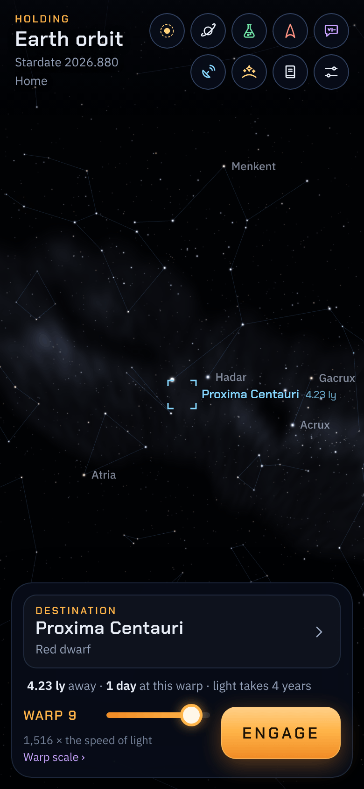
  &nbsp;
  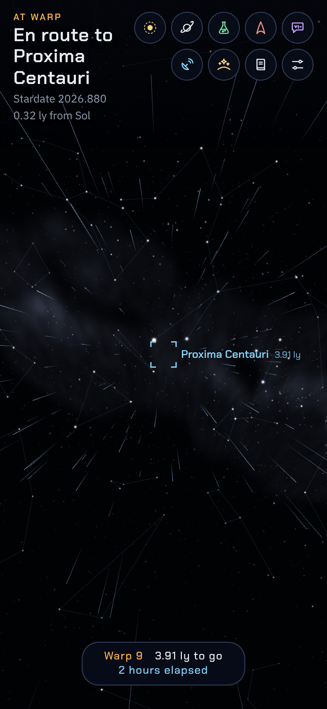
  &nbsp;
  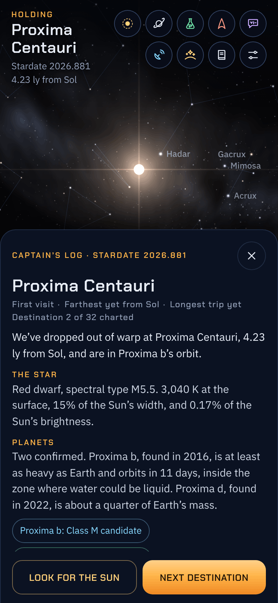
  &nbsp;
  
  &nbsp;
  
  &nbsp;
  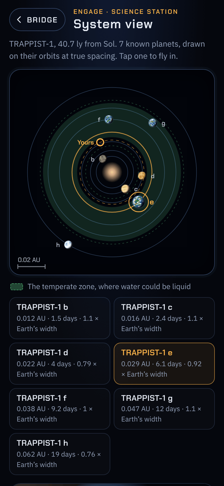
  &nbsp;
  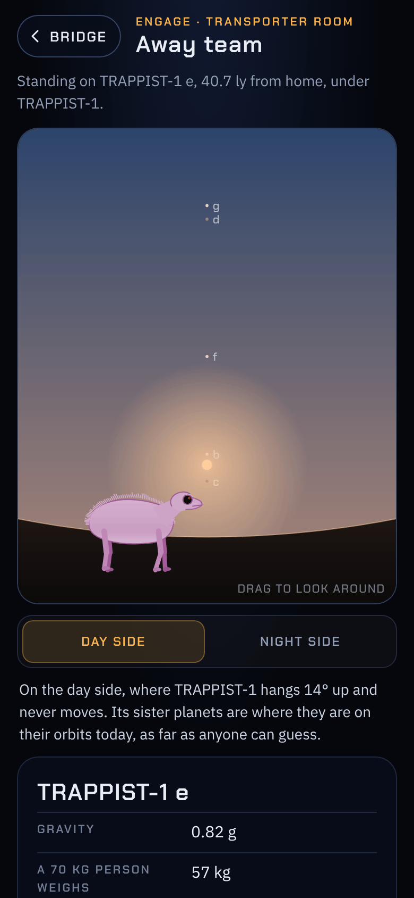
  &nbsp;
  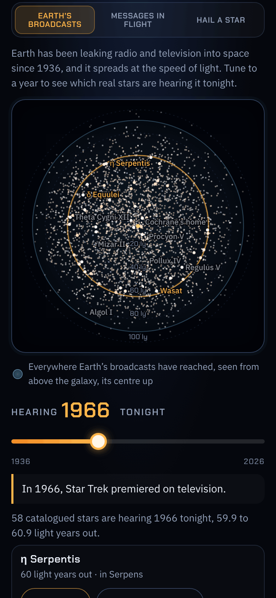
  &nbsp;
  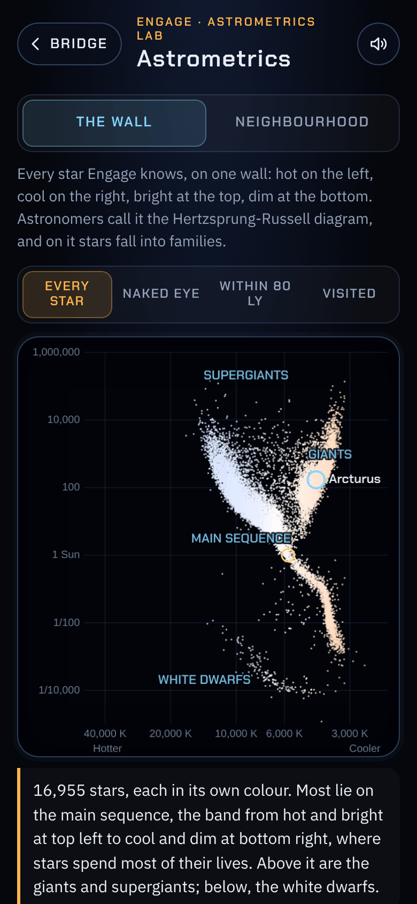
  &nbsp;
  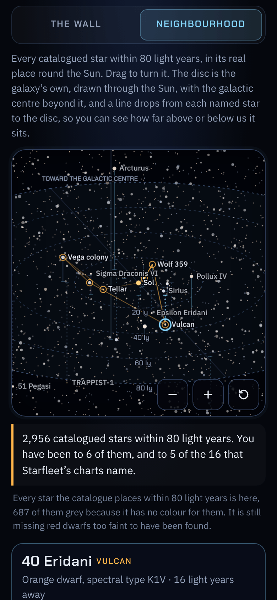
  &nbsp;
  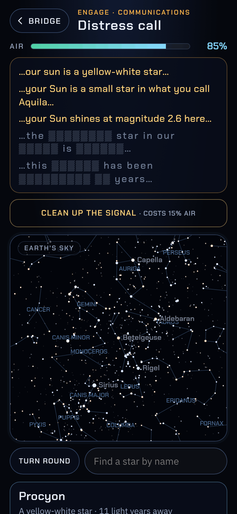
  &nbsp;
  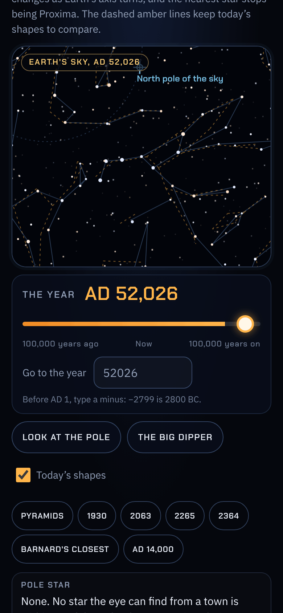
  &nbsp;
  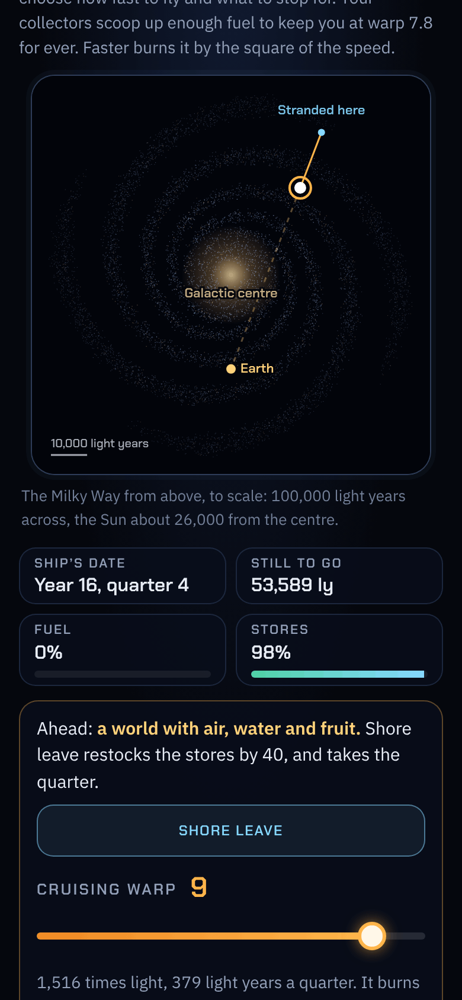
  &nbsp;
  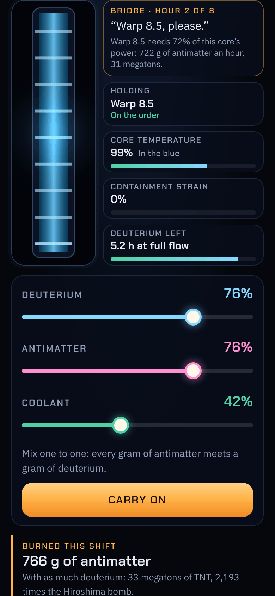
  &nbsp;
  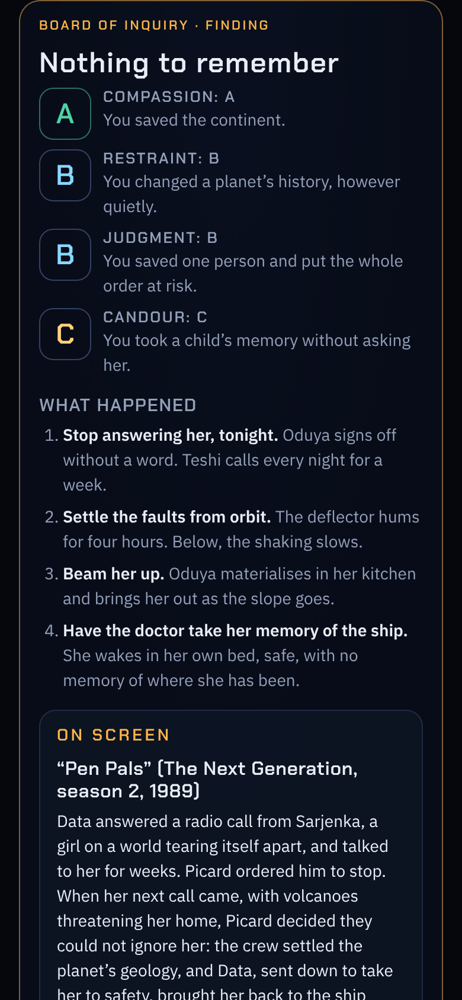
  &nbsp;
  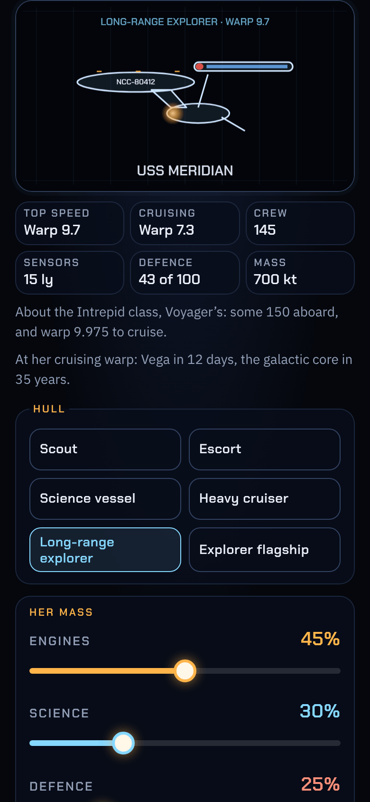
  &nbsp;
  
  &nbsp;
  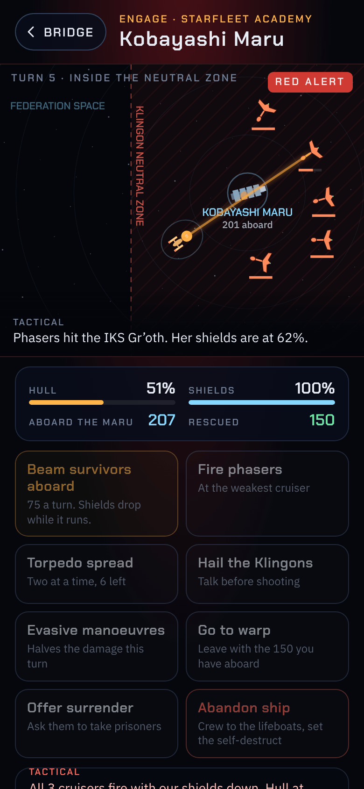
  &nbsp;
  
  &nbsp;
  
  &nbsp;
  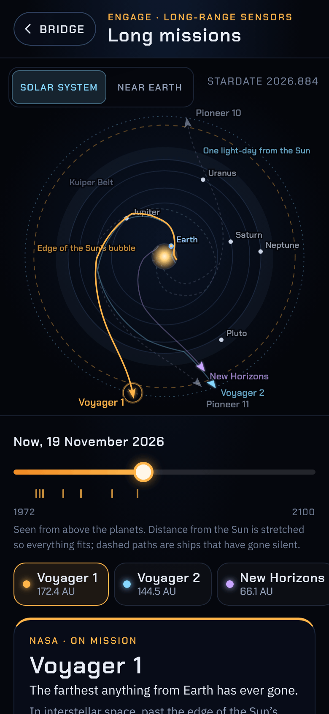
  &nbsp;
  
</p>

## How it works

- **Every star is real.** About 18,000 of them, from the HYG database: everything you can see from Earth with your eyes, plus every catalogued star within 80 light years. Each is drawn at its true position and as bright as it would look from wherever the ship is. Far from home the viewscreen thins out, because a star’s faint neighbours out there aren’t in the catalogue; the log says so once the ship is more than 250 light years out.
- **Set course.** Tap a star on the viewscreen, or choose from 35 destinations with notes (Proxima Centauri, TRAPPIST-1, Vulcan’s sun 40 Eridani, Betelgeuse…) or search the whole catalogue. Four of them, under **Nebulae and clusters**, aren’t stars but places: the Hyades, the Pleiades, the Orion Nebula and the Ring Nebula, the deep sky’s sights within 3,000 light years. The ship flies to a star in each (the Trapezium at the heart of the Orion Nebula, the white dwarf in the middle of the Ring) and holds far enough out to see it whole, and the viewscreen paints it at its true size from wherever the ship is: a haze for the Hyades’ fainter stars, the dust the Pleiades light blue, the Orion Nebula’s glowing cloud, the Ring’s red and green shell. The glow is real and the shapes are an impression, and the log says so. From Earth the Orion Nebula is a faint patch about a degree across, as it is in the real sky. Away from home, under the voyages, it lists the five stars nearest the ship. Type a year, such as 1987, and it also lists the three brightest stars that year’s light from Earth is reaching about now. The same box is the ship’s computer: ask it “nearest”, “nearest with planets”, “brightest from here”, “within 20 ly”, “red giants” (or any colour and size, “white dwarfs”, “carbon stars”), “unvisited” or “how far is Vega”, and it answers in a line, measured from wherever the ship is, with the stars to tap under it. The search knows where Starfleet’s charts put things too, at 28 real stars: Vulcan, Farpoint, Tellar, Rigel VII, Mintaka III, Regulus V, Gamma Hydra IV, Garth of Izar.
- **Voyages.** At the top of Set course, five named routes through the destinations with notes: the neighbours (and home), Starfleet’s atlas, the planet hunt, the winter sky taken apart, and the brightest seven. Each shows its stops, how far they add up to from where the ship is, and how long that is at the helm’s warp. Take one and the helm is set for its first stop; each arrival on it says in the log which leg it was (“Leg 2 of 7 of The neighbours”), and the main button under the log names the next leg and sets course for it. A detour leaves the voyage waiting; the last leg ticks it off.
- **Warp factor.** Warp 1 is light speed and warp 9 is about 1,516 times it. The helm shows how long the trip would take, next to how long light needs. The flight itself is shortened to a few seconds.
- **Drop out of warp.** The ship holds where the star’s disc looks about two and a half degrees wide, or in the orbit of a known planet. In one (Earth’s, Proxima b’s, Luyten b’s, Teegarden’s Star b’s or TRAPPIST-1 e’s) the viewscreen draws that planet near its star, painted as the survey files it: close by, 18° across, and since its star is far beyond it, lit from behind as a crescent on the star’s side. At one of the five stars that behave, the disc does what the star does, sped up, and the header says the real period (“Dims every 2.87 days · sped up”): Algol fades in its eclipse, Mira and Delta Cephei swell and fade, Betelgeuse breathes, and Proxima flickers and now and then flares. With reduced motion asked for, the disc keeps still. Under the star’s name, one line says what the arrival did: a first visit, the farthest yet from Sol, the longest trip yet, another destination charted. The log covers the star (for a giant, how far it would reach in the Sun’s place: Betelgeuse past the orbit of Mars), where a planet would get the sunlight Earth does and how big the star would look from there, for one of the five stars that behave (Algol, Mira, Delta Cephei, Betelgeuse and Proxima Centauri) where it is in its cycle as Earth sees it (“Right now”: shining at its usual magnitude 2.1, and when the next eclipse is deepest), and for an ordinary star with no notes a rough mass, how long it shines and how it ends (“about twice the Sun’s mass, good for about 2 billion years”), all worked out from the catalogue and said with an “about”; then its planets, a few notes, what Starfleet’s charts put there, the brightest star in that sky and the nearest one (with a button to set course for it), how the Sun looks from there, which year of Earth’s history its light is showing and what happened in it (“Earth as it was in 2018, the year Voyager 2 left the Sun’s bubble for interstellar space”, with a link to that ship in long missions), and when Earth’s first TV broadcasts arrive.
- **The captain’s log** keeps every arrival, under a heading for its day (“Wednesday 18 November · 6 arrivals”), with the time it was made beside its stardate. Between the arrivals, the other rooms each add a line when something there finishes, by when it happened: “Supplemental: sat the Kobayashi Maru. The lifeboat, 150 home, C B B B.” There is one for each simulation, for passing the Bridge Officer’s Test and for each rescue test (“Supplemental: sat the Academy’s rescue test. 450 home, of the 480 it allowed.”), each first or second contact, each creature kept in a jar, the latest best streak in Cover your tracks, the latest hail to each ship on a long mission, and the latest hail to each star from subspace radio (“Supplemental: hailed Vega on subspace radio. It gets there in 2051.”) with another line the day it lands, each distress call answered (“Supplemental: answered a distress call. Found at Procyon with 42% of their air left.”) and each trip home from the Delta Quadrant (“Supplemental: home from the Delta Quadrant in 58 years 3 months.”), and each leads to what it is about. It opens on the newest 50, and **Show earlier** adds 50 more. Past 30 entries it has a search box (a star’s name, or anything an entry says) and **By star**: one row for each star, the most recently visited first, with how many visits and when, opening on the newest entry for it. **Chart** is stellar cartography: every star you’ve visited, seen from above the galaxy with the Sun in the middle and the galactic centre up, each dot in the star’s own colour, and your flights drawn between them in the order you flew them, the latest brightest. Rings mark 10, 100 and 1,000 light years (and further, once you’ve been further), each ten times as far as the one inside it, so Proxima and Deneb both fit. Tap a dot for its name, distance and visits, and **Set course again**; **Save chart** makes a picture of it to send, and **The neighbourhood in 3D** opens astrometrics’ map of every star within 80 light years, with your route on it. A star with no measured distance is left off the chart, and it says so. **Print the log** lays the whole log out as a booklet, oldest first, black on white, one entry to a block; on a phone that is also how to save it as a PDF. At its head, one sentence sums the voyage up from every room’s record: “Fourteen months out: nine stars, one new species, one failed exam.” Under it, the **service record** reads every room’s record and shows the career in one card, each row leading to its room: the Kobayashi Maru’s endings seen and best grades (and the Bridge Officer’s Test, once passed, and your best in the rescue test), the peoples met and contacts made, the best streak in Cover your tracks, the creatures in jars, the ships hailed, the hails to stars sent and landed, the distress calls rescued, your trips home from the Delta Quadrant with the best of them, the shifts stood in main engineering, the hearings before the Prime Directive’s board of inquiry and the ships kept and requisitions filled at the shipyard, or what each room is still waiting for; and **the neighbourhood**: how many of the 2,956 catalogued stars within 80 light years you’ve been to, and of the 16 that Starfleet’s charts name (“6 of 2,956 stars within 80 light years · 5 of Starfleet’s 16”), leading to astrometrics’ map of them. Then come a few records worked out from the log: the farthest you’ve been from Sol, your longest trip, the star you’ve visited most, how many of the 35 destinations you’ve reached, and which kinds of star you’ve been to (the classes O B A F G K M light up as you visit one of each, and a red supergiant, white dwarf, carbon star or Wolf-Rayet star is named once you’ve seen one). Open an entry (or the arrival’s own) to **Save a picture**: a tall card, 1080 × 1620 like the lab’s creature card, of the viewscreen at that star (as it is on screen when the ship is there, or drawn again from where it held, facing the star as it arrived), its name, the stardate and what the entry says about seeing home, for your phone’s share sheet or as a download. Open one to **Set course again** for its star, to find it **In your sky tonight**, or to **Share this course**: a link that sets the same course on someone else’s bridge. For the 34 destinations with notes (all but home) the link is a page of the star’s own, such as `engage.junkdrawer.works/course/vega.html`, so it previews in a chat as that star (“Set course for Vega”, Starfleet’s story or a line from its notes, and the star as the viewscreen shows it on arrival, with “25 light years · the Vega colony”) and passes straight on to the bridge; any other star’s link is `engage.junkdrawer.works/?course=Alpheratz`. Both kinds of link will keep working. On a first visit the welcome card then opens with the course it brought: “A course is laid in for Vega, 25 light years out. Take the helm and engage.” On a screen 1,200 pixels wide or more, **Pin open** on the log’s header keeps it open as a column down the right while you fly, so each arrival (autopilot’s too) adds to a log you can see; it stays pinned until its close button unpins it, and until then the bridge looks as it always has.
- **Today on the bridge** heads the captain’s log: what is new today across the rooms, worked out in the page from the date, the same for every officer that day. At its top is **this week’s assignment**, one a week from Monday to Sunday, the same for every officer that week, from 23: survey a real star group (four of the Pleiades’ nine named stars, three of the Hyades’ five, five of the Big Dipper’s seven, Orion, the Summer Triangle, the Winter Hexagon, the Southern Cross, Cassiopeia’s W or the Northern Cross), visit four of the 50 stars within 15 light years of home or three of Starfleet’s charted stars, explore eight stars you’ve never been to, cover 500 light years, fly four legs of the voyages, carry out four orders of the day, or a room’s work (three distress calls, three Kobayashi Maru runs, three hails in first contact, three jars, three hails to stars, three long missions hailed, two hearings, two ships laid down). The weeks go through all 23 in a shuffled order before any comes round again. It has a bar for how far along it is (“2 of 3”, “420 of 500 light years”) and a way to get on with it: a course for the nearest star it still wants, or its room. Carried out, it says on which day and adds a line to the log (“Supplemental: carried out the week’s assignment from Starfleet, “The Southern Cross”.”); a missed week costs nothing, and Monday starts the next. Then come **orders from Starfleet**, one a day: proceed to a charted destination and report how our Sun looks from there, the brightest star in its sky or its planets (the arrival’s log entry answers it, and the card quotes it), or sit today’s Kobayashi Maru, answer today’s hail or today’s distress call, keep a creature in a jar, hail a star or a long mission, sit a hearing before the board of inquiry, visit a star you’ve never been to, fly a leg of a voyage, or cover 100 light years in a day. An order is carried out by doing it that day, wherever you do it (a ship already holding at the star it is sent to has proceeded there, and its latest entry reports); the log counts each order of the last fortnight on its own day, so one done while the log stayed shut still counts. The bridge itself says the day’s order in one line under where the ship is (“Orders from Starfleet: proceed to Vega.”, or once it is done, “Today’s orders are carried out.”): tapping it opens the log at Today on the bridge, and closed or followed it stays away until the next day’s order. It makes no sound, and a first visit, which has the welcome card to read, doesn’t get it. Under it, today’s simulation, hail, distress call, Cover your tracks exam, rescue test and the shipyard’s requisition, each ticked once done; a friend hailing again; a hail to a star landing today; a long mission’s answer to your hail due today, or come in (“Voyager 1’s answer is due today · At 18:40, at the speed of light”); a trip home under way. At its foot, your **days served**: any day something went in a room’s record counts, and a **tour of duty** goes on while no two days in a row are missed (one day off is forgiven, and missing more ends only the tour, never what was served). The **service record** gives your **rank**, from Cadet through Ensign, Lieutenant junior grade, Lieutenant, Lieutenant Commander and Commander to Captain, and what the next one needs (stars visited, rooms on the service record, days served and orders carried out: Ensign is 10 stars and one Kobayashi Maru; Captain is 300 stars, ten rooms on the service record (of the eleven), 60 days served and 50 orders). Under the rank it counts the weekly assignments you’ve completed (“Weekly assignments: 3 completed”). Under its rows are your **commendations**, Engage’s own: Cartographer (every charted destination), No-win scenario (all nine Kobayashi Maru endings), Linguist (all five linguist’s challenges), Search and rescue (ten crews), Deep space (1,000 light years from Sol), Xenobiologist (twelve jars), Home early (under 60 years), A week on duty (a seven-day tour), By the book (ten orders) and Special assignments (four weekly assignments), with the nearest one still to come and how far along it is. A day’s promotion or commendation is said on today’s card. The ranks are Starfleet’s; the thresholds, orders and commendations are the game’s. What has been earned (days served, orders carried out, weekly assignments, rank and commendations) is kept in the bridge’s save, `engage.v1`, so a rank is never taken away, even if the log is cleared; it goes in the ship’s records file, and Add to what’s here keeps everything earned on either copy.
- **The rooms off the bridge.** The welcome card lists the seventeen rooms, each with its picture and a line on what it is, and each a link (seven have a round button on the bridge; the system view and the away team are reached from a star’s planets in the log, subspace radio from a log entry’s line about Earth’s broadcasts and from the foot of Set course, and astrometrics from the line on what kind of star it is; the distress call, the temporal observatory, the long way home and main engineering are reached from this list alone for now, the shipyard from it and from the service record, and the Prime Directive from it and from the Kobayashi Maru’s briefing). On a phone on its side the card lists each room by its picture and name alone, four to a row, so Take the helm is about a screen down. Bridge settings keeps the same list, and **Show the welcome again** brings the card back. When a room has been added since your last visit, one line under where the ship is says so, with a link to it (“New since your last visit: System view and Away team.”), until you close it or open the room. The round buttons are drawn small, but each can be tapped anywhere in a 44-pixel square round it.
- **The five-year mission**, a switch in Bridge settings that starts off. Each arrival adds the trip’s time at warp to a running total, so a slow warp factor costs something: the header shows “Year 2, day 114 of 5” where the stardate was, and the helm says where a trip would leave the mission (from Earth, Betelgeuse at warp 6 is 15 months of it; at warp 9.9, about two months). The arrival that reaches five years closes the mission, says so, and leaves a summary in the log over that arrival (its stars, light years, ship time, dates and records, and what the other rooms logged while it lasted); the next trip starts the next mission. With it on, the log’s sentence is the mission’s (“Year 2, day 114: nine stars, one new species, one failed exam.”) and the service record opens with the clock. Nothing is deleted, and switching it off puts everything back as it was: the clock is worked out from the log, which keeps each trip’s warp factor for it.
- **Your ship.** Bridge settings can give her a name and a registry (“Calypso”, “NCC-74210”), and the rooms that speak of her use them: the Kobayashi Maru’s briefing (“You command the USS Calypso”), first contact (“off the Calypso’s bow”), the captain’s log and its service record, and your lane on the warp scale. A name typed with a prefix of its own (SS Botany Bay) keeps it; any other is the USS. Unnamed, she is spoken of as before.
- **Look for the Sun.** The ☉ button turns the view toward home, marked even when it’s too faint to see.
- **Autopilot**, in Bridge settings (or F at a keyboard): the helm and the round buttons go, the screen goes full and stays awake, and the ship flies itself. A voyage under way flies its next leg; otherwise it goes to the nearest destination with notes not yet in the log, then the brightest named stars, and once it has been everywhere, wherever it was longest ago. At each star it holds about 20 seconds with two lines on screen, its name and what it is, then goes on. Its first stop at each star goes in the log, and every leg of a voyage; later rounds fly and hold but write nothing, so a night left running adds no repeats. Any key or touch takes the helm back, and does nothing else (a flight under way finishes first). With reduced motion asked for, each flight is the usual cross-fade.
- **Earth’s sky, held to compare.** Away from the Sun, press and hold **Earth’s sky** beside the log entry’s date: the viewscreen fades to the same direction as seen from home, the constellation lines back in the shapes everyone knows and the star you’re at ringed among them (“Betelgeuse, you are here”, at Orion’s shoulder). When the star you’re at would be out of sight from home (off the screen or under the log, as it often is after a leg from one star to another), Earth’s sky faces it instead, ringed in the clear part of the screen among the stars round it in Earth’s sky. Let go and it fades back to the sky from where you are. Space or Enter holds it too.
- **Sound, text and keys, in every room.** Each room’s header has a speaker that turns Engage’s sound off and on everywhere at once (M at a keyboard does the same); Bridge settings calls it **Sound**. On Android a short buzz goes with going to warp and dropping out (not on autopilot), and with each hit on your ship in the Kobayashi Maru, under its own **Vibration** switch (iPhones can’t vibrate for a page, so they have no switch). **Text size** (Standard, Large, Largest) is counted from your browser’s own text size, so a browser set to larger text starts larger here too (on an iPhone, its own Larger Text setting), and the words drawn into every room’s pictures (the viewscreen, tonight’s sky, the maps, charts and plots) grow with it. **High contrast** makes the panels solid, the secondary text and lines brighter and every outline twice as thick, and draws the pictures’ labels and lines brighter and a little heavier, in the same colours. At a keyboard, ? in any room opens a card of its keys: on the bridge E engages, H looks home, L opens the log, [ and ] nudge the warp, N steps the destination through the named stars in view and R reports; the Kobayashi Maru gives its orders on 1 to 9; first contact adds notebook phrases on 1 to 9, sends on Enter and listens again on L.
- **Computer, report.** **Report**, on the helm, says in a line above it what is on the viewscreen: where you are looking, the three brightest stars in view, where the Sun is and how bright, and where the destination is, and says it again once the view is still after moving. In flight it tells the trip in four lines: setting out, halfway, closing in and dropping out of warp. It stays on until turned off, and a screen reader reads it. The ship’s computer in Set course answers “report” or “what am I looking at” with the same line.
- **Drag to look around, pinch or scroll to zoom.** With a keyboard, the arrow keys look around, + and − zoom, and / opens Set course, where the up and down arrows move through the list and Enter takes a star. Where you were looking and how far you had zoomed are kept. Follow a link out of a log entry to another room and come back, and the entry is open again where you left it. Back, or a phone’s back gesture, closes the sheet that’s up (Set course, the log, settings, a new log entry) instead of leaving the page, and on a phone a sheet can be dragged down by its head to close it; tonight’s sky’s list, places and star cards work the same way.
- **The planetary survey** ([survey.html](https://engage.junkdrawer.works/survey.html), the ringed planet on the bridge) flips through Starfleet’s planet classes, from Class M to Demon class, next to the kinds astronomers have really found that Starfleet never named: super-Earths, sub-Neptunes, lava worlds, hot Jupiters and ice giants. Each file has typical readings, the Solar System’s examples, and real planets that fit, with **Set course** to fly there and **In your sky tonight** to find its star, and **Share this file** sends a link to it. A third group holds nine moons and dwarf planets, the Moon, Io, Europa, Ganymede, Titan, Enceladus, Triton, Ceres and Pluto, each with its real readings from NASA’s fact sheets (Titan is 5,150 km across, with nitrogen air at about one and a half times Earth’s pressure and 94 K), the Starfleet class it would be filed under and why, and the lab: Europa and Enceladus grow a creature under their ice, and Titan, whose seas are methane, waits for rules of its own. The log links back to the files for the planets it mentions. **Cover your tracks** shows an unlogged world’s sensor readings and asks which file it would pass for, and says so when you beat your best streak. Three more rounds sit beside it: **Sensors only** gives the numbers alone (width, mass, temperature, year), with no picture and none of the files’ own words on air, water and life; **The other way** names a file and offers four worlds by their numbers, one of which would pass for it; and **Today’s exam** is five worlds of five files, the same for everyone that day, ending in a result card with a line to send (“Cover your tracks, 19 Nov: 4 of 5 filed”) and a link, `survey.html#exam`. The exam leaves the streak alone, and one left part-way picks up where it stopped. Under the score, a badge for each of the 17 files lights up once you’ve rightly filed a world under it (“11 of 17 files used”), and once you’ve made the same slip twice, one line names the one you make most: “Most often caught out: Class K, mistaken for Class D (3 times)”. **Long-range sensors** is a planet hunt: how anyone knows a planet is there at all. It draws a star’s light reading by reading, with its scatter, in rows of days; tap three of the dips for the planet’s year, set a line at the floor of the dip, and it gives the size (the star dims by the square of the planet’s width over its own: “0.5% dimmer, so the planet is about 7.1% of its star’s width: about Earth’s size”), then asks which survey file it is, and names the real planet, how it was found, with its file and **Set course** where the bridge can fly there. **Deep dips** is a hot Jupiter or a warm Neptune; in **Too faint to see** (55 Cancri e, π Mensae c) no single pass shows, and you try years until the passes, added up, make a dip; **Seven worlds** is TRAPPIST-1, whose seven planets’ dips are mixed together; and **The wobble** is 51 Pegasi b as Mayor and Queloz found it in 1995 (*Nature* 378, 355), from its star’s speed rising and falling every 4.23 days, which gives at least half Jupiter’s mass. The planets’ years, widths and stars are the NASA Exoplanet Archive’s, each with its paper. Every curve has a link that draws the same one again (`survey.html#hunt=2.4187`), for a teacher to send to a class. **Your stars** lists home and every star in your captain’s log, newest first, each opening the system view to place a planet round it. A real planet the system view has gets **System view** and, if it has ground, **Beam down**.
- **The system view** ([system.html](https://engage.junkdrawer.works/system.html), from **System view: fly in to its planets** in a log entry’s planets, or **System view** beside a real planet on a survey file) draws a star’s real planets from above, each on its orbit at true spacing and painted the way the survey would file it, with the temperate zone shaded: where a planet like Earth could keep liquid water, from Kopparapu and others 2013 (*Astrophysical Journal* 765, 131; 0.99 to 1.70 AU for the Sun), with their wider Venus and Mars edges dashed. It has the 35 planets of Sol, Proxima, Luyten’s Star, Teegarden’s Star, TRAPPIST-1, Barnard’s Star, Epsilon Eridani, 55 Cancri, Pollux, 51 Pegasi and Tau Boötis, from the NASA Exoplanet Archive and NASA’s planetary fact sheet, each with its source (a giant’s width, which nobody has measured, is the archive’s estimate from its mass, and says so). The Solar System’s planets stand where they are today; an exoplanet’s place along its orbit isn’t known, so they are spread out and go round at their true pace, and the page says so. Tap one and the ship glides in: the planet lit from its star, the star from that orbit drawn beside the Sun from Earth to the same scale, and its orbit, year, size (a minimum mass says so, and its width is what rock that heavy would be), sunlight, temperature and where it sits against the zone. It opens at the planet the bridge holds in the orbit of, so Earth orbit shows Earth. **Place a planet**, under it, works round any star with a measured distance: drag its orbit, pick a size from the Moon to Jupiter, and it says the light it would get, the temperature its star alone would warm it to (with Earth’s reflectivity, by which Earth itself is 255 K), where the zone falls, and the survey file it would go on, with **Grow a creature for it**: the lab grows one from that planet’s own size, warmth and starlight (as it does for Proxima b), says where you placed it, and keeps it in a jar like any other. **Place a planet here** beside a log entry’s temperate orbit opens it at that star.
- **The away team** ([away.html](https://engage.junkdrawer.works/away.html), **Beam down** in the system view or on a survey file) stands you on one of the 22 planets in the system view small enough to be rock. The horizon is drawn from the real catalogue as seen from that star: by day its sun at its true width and colour (from Proxima b 1.7°, a little over three times ours; from TRAPPIST-1 e four times), by night the stars and the constellations’ lines come apart, with the Sun ringed and its magnitude given (5.3 from TRAPPIST-1), or a line saying it is in the daytime sky just now. Sister planets are discs as wide as they look from there, lit on their sun’s side. A readings strip gives the gravity, what a 70 kg person weighs, the year, the sunlight, the sun’s width, and for a world close to a small star, that it is expected to keep one face to its star, so the sun never sets (Barnes 2017, *Celestial Mechanics and Dynamical Astronomy* 129, 509). On Proxima b, Teegarden’s Star b and TRAPPIST-1 e the lab’s creature for that world stands in front of you, with a link to it in the lab. Drag, or the arrow keys, to look round.
- **Subspace radio** ([radio.html](https://engage.junkdrawer.works/radio.html), from **Subspace radio: what it hears from Earth** under a log entry’s Looking home, or the foot of Set course) is the log’s line about Earth’s broadcasts with somewhere to go. Tune the dial to a year from 1936 to now and the map, every star within 100 light years seen from above the galaxy, lights the shell where that year’s broadcasts are tonight: “58 catalogued stars are hearing 1966 tonight, 59.9 to 60.9 light years out”, under what was on the air or what happened that year (“In 1966, Star Trek premiered on television”), with three of them named, each with **Set course** and **In your sky tonight**. Tap a star on the map, or come from the log, and the dial turns to the year it is hearing. **Messages in flight** lists the real messages people have aimed at real stars, from the Arecibo message (1974) and CALL to the COSMOS’83 (Altair, arrived about 2000) to Sónar Calling GJ273b (Luyten’s Star, due about 2030), each with a bar for how far it has gone, worked out from the day it left and the catalogue’s distance (sources: Wikipedia’s “List of interstellar radio messages” and its articles). **Hail a star** sends a hail of your own to any star with a measured distance and keeps it, one to a star, with when it lands. Links: `radio.html#year=1969`, `radio.html#star=Vega`, `radio.html#messages`, `radio.html#hail=Vega`; your hails are kept under `engage.radio.v1` and go in the ship’s records file with everything else.
- **Astrometrics** ([astrometrics.html](https://engage.junkdrawer.works/astrometrics.html), from **Astrometrics: where this star sits** under a log entry’s The star, and from the log’s Chart) puts every star Engage knows on one wall: hot on the left, cool on the right, bright at the top and dim at the bottom, each dot in its own colour. Astronomers call it the Hertzsprung-Russell diagram, and on it the stars fall into families: the main sequence, the giants, the supergiants and the white dwarfs. Four filters each teach something: **Every star**; **Naked eye**, nearly all giants and stars hotter than the Sun, the ones bright enough to see from far off; **Within 80 ly**, where red dwarfs are the most common kind and giants are hardly there; and **Visited**, your log. Tap a star for its card (what it is, how far, its family, temperature and light, **Set course**, **In your sky tonight**). **The Sun’s life** slider walks it along its real track (Sackmann, Boothroyd and Kraemer 1993) from the main sequence to a red giant 166 times its width, then shedding its layers, and ending as a white dwarf where 40 Eridani B, beside Vulcan’s sun, sits now. The wall leaves off, and says so, the 758 stars the catalogue has no colour for and the 67 too red for its colours to give a temperature (each lot would draw as one false stripe), and the 407 with no measured distance. Its second view, **Neighbourhood**, is every catalogued star within 80 light years (2,956 of them) in its real place round the Sun, turned with a finger (or the arrow keys, + and − to zoom). The disc through the Sun is level with the galaxy’s, the galactic centre beyond it, and a line drops from each named star to it, solid from above and dashed from below, so you can read how high or low it sits; Starfleet’s stars go by Star Trek’s names (Vulcan, Wolf 359, Tellar), and the stars in your log are ringed in amber with your flights drawn between them. Under it, how many of the 2,956 you’ve been to and how many of the 16 Starfleet’s charts name, and **Set course** for the nearest star you haven’t been to, and the nearest of Starfleet’s; a list of the named stars there picks one without the map. A star’s card there says how far above or below the disc it is (“10 light years below the disc”). The 687 the catalogue has no colour for are drawn grey. Links: `astrometrics.html#star=Vega`, `#filter=eye` (or `near`, `visited`), `#sun=4`, `#view=neighbourhood` (with `&star=Keid`).
- **The distress call** ([distress.html](https://engage.junkdrawer.works/distress.html), from the room list on the welcome card and in Bridge settings) is a puzzle on Earth’s real sky. Survivors on a crippled ship can’t say where they are, only what their sky looks like, and the call opens with two clues: the colour of their sun and the constellation our Sun sits in as they see it (“…your Sun is a small star in what you call Aquila…”). Drag round Earth’s sky (pinch or scroll to zoom, **Turn round** to face the opposite way, or find a star by name), tap a star for its colour and distance, and **Lock on**. Their air runs down as you look; **Clean up the signal** makes out one more clue, how bright our Sun is there, the brightest star in their night, then how long the signal has been travelling, for 15% of it, and a wrong lock costs 20% and says which clue rules that star out (“Not Vega: its light is white, and theirs is yellow-white”). The calls come from the 77 stars bright enough to see from a suburb (magnitude 4.5) and near enough that our Sun can still be seen from them (60 light years), one to a system, and no two give the same clues. Every clue is worked out from the catalogue the way the captain’s log works out its own: from Procyon the brightest star in the night is Sirius, and our Sun is a magnitude 2.6 star in Aquila. The debrief puts you in their sky, centred on our Sun with it and their brightest star labelled, beside Earth’s, with **Set course** and **In your sky tonight**. **Today’s call** is the same call for every officer that day, and it counts from the moment you begin it: left partway, it goes down as lost, so it can’t be tried again with the answer known (**Answer a new call** is always there to practise). The record (calls answered and rescued, and each call) is kept under `engage.distress.v1` and goes in the ship’s records file.
- **The temporal observatory** ([temporal.html](https://engage.junkdrawer.works/temporal.html), from the room list) turns Earth’s sky to any year from 100,000 years ago to 100,000 on, on a dial that is finer near now (or type a year). Every star moves in a straight line at its own speed through space, from the HYG catalogue’s proper motions, distances and radial velocities (`data/motion.bin`, built by `tools/build-motion.py`), which is good to about 100,000 years by this catalogue. Dashed amber lines keep today’s constellations to compare, and the north pole of the sky moves round its circle once in 25,772 years as Earth’s axis turns (the IAU 2006 precession, at today’s tilt). Beside the chart: the pole star (Thuban, 0.3° from the pole in 2800 BC; Polaris now; none in Caesar’s day; Vega, 4.4° off in AD 14,000), the nearest star (Proxima now; Alpha Centauri from about AD 4,800, by this catalogue), the brightest, and which bright star has moved furthest. **Moments**: the pyramids, 1930 (“The City on the Edge of Forever”), 2063 (first contact), 2265, 2364 (where the sky has hardly moved, which is the point), Barnard’s Star at its closest (3.66 light years in about AD 11,970 by the catalogue’s straight line; published reckonings say about 3.75, around AD 11,800) and AD 14,000. A star with no measured distance stays put, and so do three the catalogue has racing through space at over 400 km/s, which the page names. Links: `temporal.html#year=14000`; before AD 1, a minus (`#year=-2799` is 2800 BC).
- **The long way home** ([longway.html](https://engage.junkdrawer.works/longway.html), from the room list) strands you in the Delta Quadrant, 70,000 light years from Earth, as Voyager was in “Caretaker”. Each turn is a quarter of a year: choose a cruising warp on Engage’s own scale and what to stop for, and watch the ship cross a to-scale map of the Milky Way from above. The collectors scoop up enough fuel to cruise at warp 7.8 for ever, the pace at which the trip takes the 75 years the crew were told; faster burns fuel by the square of the speed, so flat out (warp 9.975) empties full tanks in about six weeks and the ship falls back to 7.8. A nebula ahead refills the tanks by 40 and a world with air and water restocks the stores by 40, each for a quarter’s stop; with the stores empty the crew can’t run her past warp 6. **Cruise on** flies quarter after quarter until something needs a decision. Neither crawling at 7.8 nor flying flat out is fastest: a middle pace with every fuel stop gets home in under 60 years. The debrief says how long it took against the show’s 75 years and the 10 that warp 9.975 would take if the fuel lasted. The trip under way is kept under `engage.longway.v1`, with your best time and your latest 50 trips home; the fuel, stores and stops are a game’s, not canon.
- **Main engineering** ([engineering.html](https://engage.junkdrawer.works/engineering.html), from the room list) is a warp core to keep steady through one shift: eight orders from the bridge, an hour each, held for twelve seconds of play (“Warp 8.5, please.”). Three sliders feed it deuterium, antimatter and coolant. Matter and antimatter annihilate mass for mass, so the core burns as much antimatter as it has deuterium to meet; antimatter with nothing to meet strains the magnetic containment, and so does a core run past its limit. Deuterium beyond one to one isn’t burned but runs through and carries heat away, at the cost of a tank that holds six hours at full flow; coolant carries heat away too, but its pumps take power from the warp coils. Strain it to the limit and the core is ejected. The order says what that warp factor costs this core (“Warp 8 needs 64% of this core’s power: 640 g of antimatter an hour, 27 megatons”), and the end of the shift grades the share of it you held the order and holds what you burned against real yardsticks: a kilogram of antimatter meeting a kilogram of matter gives E = mc² for 2 kg, 1.8 × 10¹⁷ joules or 43 megatons; the Hiroshima bomb was about 15 kilotons, the Tsar Bomba 50 megatons, and the world used just over 600 exajoules in 2025 (Energy Institute, Statistical Review of World Energy 2026). A card sets Starfleet’s two answers to how rich the mix should be side by side: the Next Generation Technical Manual’s 25 to 1 at idle, 10 to 1 at warp 1 and one to one at warp 8 and above, and the one right answer, one to one, on Wesley Crusher’s Academy exam in “Coming of Age”. The core’s size, the power each warp factor needs and how it heats are the game’s, not canon. The record (shifts, the best share held, antimatter burned in all, cores ejected) is kept under `engage.engineering.v1`.
- **The Prime Directive** ([directive.html](https://engage.junkdrawer.works/directive.html), from the room list and from the Kobayashi Maru’s briefing) is a board of inquiry at the Academy, with no fight in it. General Order 1 forbids interfering with a people who haven’t reached warp, not even letting them know you exist, and the case is one where it and the right thing pull apart: in *The voice on the radio*, a science officer has been answering a girl’s radio calls from a pre-warp world whose crust is coming apart. You give three or four orders, each with what came of it, and the board grades your compassion, restraint, judgment and candour, each with its reason (“Candour: C. You took a child’s memory without asking her.”), and tells you what a captain on screen did with a case like it: Picard in *The Next Generation*’s “Pen Pals” (season 2, 1989), as Wikipedia’s article on the episode tells it, and how many of your orders were his. It isn’t rigged: every path costs something, and none of the case’s 39 earns an A in all four. The case, its world and its people are the game’s. The hearings (the last 30) are kept under `engage.directive.v1`.
- **The shipyard** ([shipyard.html](https://engage.junkdrawer.works/shipyard.html), from the room list) designs ships of your own; they aren’t the ship you command, whose name stays in Bridge settings. Pick one of six hulls (a scout, an escort, a science vessel, a heavy cruiser, a long-range explorer or an explorer flagship), split her mass between engines, science and defence on three sliders that always add up to 100, and she is drawn side on in the drydock, nacelles as long as her engines are big and the deflector as bright as her science, with her top warp, cruising warp (a third of her top speed, on the warp scale’s own curve; nothing goes past warp 9.975), crew, sensor reach, defence and mass, and how long she takes to Vega and to the galactic core. Each hull says which real class she is about the size of, from Memory Alpha (the Defiant’s 50 aboard and warp 9.5, the Constitution class’s 430, the Galaxy class’s thousand or more); how mass becomes speed, crew, sensors and defence is the game’s. Give her a name and a registry (or **Suggest a name**) and **Keep her**: up to 40 are kept, each with **On the bench** to change her, **Race her on the warp scale** (a link, `warp.html?ship=yard:…`, that puts her in the bottom lane at her cruising warp on anyone’s warp scale, where the picker lists every ship you’ve kept), **Send her** (`shipyard.html#ship=…`, which opens her on a friend’s bench to keep) and **Scrap**. Each day **Starfleet’s requisition** asks for one kind of ship, the same for every officer (“A ship to carry colonists to 40 Eridani. Room for 200 aboard; cruising at warp 6 or better”): some designs meet it and no more than a third do, the card says how the one on the bench falls short, and keeping one that meets it fills it. Each ship kept adds a line to the captain’s log (“Supplemental: laid down the USS Meridian at the shipyard, and filled Starfleet’s requisition with her.”), and the service record counts the ships kept and the requisitions filled. Add to what’s here puts two shipyards together.
- **The xenobiology lab** ([xeno.html](https://engage.junkdrawer.works/xeno.html), the green flask on the bridge, or **Grow a creature** on any survey file) grows a creature for whichever planet class you pick, drawn in its home next to a person or a scale bar. The world decides the body: stronger gravity means more, thicker legs and a smaller animal; thick air and gentle gravity grow wings; a red dwarf’s dim light means huge eyes and near-black skin; no light means no eyes at all; heat grows a radiator sail, cold grows fur; above about 180 °C the lab gives up on water and guesses at a body of rock, like the Horta. Four field notes explain each choice, and a line says how seriously to take it. **Grow its neighbours**, under the notes, grows two more creatures for the same spot by the same rules, what it eats and what eats it, drawn smaller in the tank beside it, each with a note on why it has its shape (“At 2.8 g a hunter can’t leap or chase without breaking a leg, so it waits low beside the trail and lunges”); a gas giant’s are the sinkers and hunters Carl Sagan and Edwin Salpeter imagined beside the floaters in Jupiter’s clouds (*Astrophysical Journal Supplement* 32, 737, 1976). Plants, and the crawlers of bare rock, have none. Gas giants grow drifting gas bags, ocean worlds grow swimmers, Class L grows plants (it has no animals), and every creature has a name put together from what is true of it (its colour, coat, eyes, size and build, and where it lives), a Latin one to go with it, and a link that brings it back: **Send this creature** shares it. **Save a picture** draws a tall card of the creature in its scene, with its name (and yours, if its jar has one), its four field notes’ headings and “Grown in the xenobiology lab”, and hands it to the phone’s share sheet, or downloads it where the browser can’t share a file; it is all drawn in the page. Star Trek species and real Earth life sit alongside as reference specimens, and **Keep in a jar** saves the ones you like, and tapping a jar’s name gives it one of your own (“Biscuit”), shown above the creature’s on the shelf and on its card. The lab only ever rolls specimen numbers 1 to 9,999, so it can grow exactly 169,983 creatures, and every one has been counted: a card says when its body plan is rare for its class (“Uncommon: 171 of Class M’s 9,999 specimens fly”, and for specimen 1218, “One of a kind: the only Class H specimen that flies”), and **Lab records** links to the six record-holders, from a gas bag a kilometre across to a crawler half a millimetre long. Six real planets have a button of their own on their survey files and in the log, such as **Grow a creature for Proxima b**, and so do Europa and Enceladus, whose creatures always live in the sea under the ice: the lab then uses the planet’s own measured mass, width, temperature and star (a width nobody has measured is worked out “if it is rock”), and a fifth note says what is really known about it. Their links read `xeno.html#world=Proxima%20b-42`, beside `xeno.html#M-42` for a class. The **Bench** tab beside **Grow** grows the creature in the tank again under readings you set on four sliders: gravity (marked at the Moon, Mars, Earth and Jupiter, from NASA’s planetary fact sheets), air (Mars, Earth and Venus, down to none at all), light (no star, a red dwarf, an orange dwarf, a Sun-like star) and heat (where water freezes and boils, and where the lab gives up on it). It starts as the same animal, and a slider changes only what its reading decides: the parts that change glow for a moment, that reading’s field note lights up, and a line says which survey file the readings would pass for (“These readings would pass for a super-Earth”). **Back to its own readings** puts it back, **Grow** returns to the creature it started from, and the link keeps the readings: `xeno.html#bench=M-42&g=2.5&air=1&light=red&heat=288`. **Compare two**, over your jars, puts two of them side by side: both creatures, their gravity, air, light and heat in a row each (marked when they’re alike), and one sentence from the difference that matters most (“Air: 0.017 atm against 1.1 atm. That is why one breathes through sacs along its back and the other breathes much as we do.”). **Send this pair** shares a link that opens the same two for anyone: `xeno.html#pair=K-8371&M-42`.
- **The Kobayashi Maru** ([maru.html](https://engage.junkdrawer.works/maru.html), the Starfleet delta on the bridge) is the Academy’s no-win test. The fuel carrier *Kobayashi Maru* is adrift inside the Klingon Neutral Zone with 381 aboard. Give one order a turn: hail, cross the line, beam survivors over (your shields drop while the transporter runs), fire, evade, go to warp, offer surrender or abandon ship. The simulation is rigged the way the Academy rigs it: the Maru is always lost and the cruisers keep coming. The briefing says where the film puts her, Gamma Hydra, Section 10, and links to the real Gamma Hydrae in tonight’s sky and at the helm. At the end the examiners grade how you lost on compassion, judgment, restraint and nerve, and say what cost you any grade below an A; Judgment never goes above a B, and the evaluation says so when you reach it. Hailing the Klingons buys one quiet turn, and it is really free: their fire, their attack on the Maru and their reinforcements don't count it. Under the verdict, the examiners' archive says how rare your ending is: how often the simulator ends that way when it is given orders at random (“About 1 in 14 ends this way”), and a run that brings 150 home is told nobody has brought more. The evaluation says what the run added to your record: an ending you hadn’t seen (“New ending · 2 of 9 seen”) and any grade that beat your best. Your record stays on the briefing: which of the nine endings you’ve seen (the rest stay unnamed), your best grade in each, and your latest runs. Come back and the examiners open the briefing with a line for you (“Third attempt. The board notes your persistence.”). **Today’s simulation** throws the same dice for every cadet that day; once you’ve taken it, the briefing keeps the line to send (“Kobayashi Maru, 18 Nov: The lifeboat, 150 home, C B B B”). **Share this run** sends that line with a link (`maru.html#run=…`) that plays your run back, turn by turn, for whoever opens it, then shows them your evaluation and offers them the same simulation with the same dice; nothing goes on their record. After your first run you can reprogram the simulator, as one cadet did. A simulation you leave part-way is kept, and the briefing offers to resume it. A second test waits under the briefing: **the Bridge Officer’s Test**, after *The Next Generation*’s “Thine Own Self” (season 7, episode 16): a damaged ship, six minutes to a warp core breach, and seven sensible things to try that don’t work. The one that does is to order the chief engineer into a flooded compartment he won’t come out of; the board’s verdict says what the other orders were for, and the briefing keeps whether you’ve passed. A third waits under it: **the rescue test**, Engage’s own (no episode has it). Two ships are in trouble millions of kilometres apart, each with her own few minutes (a warp core about to breach, a hull breaking up, failing air, a fall into the star or a radiation storm), and the transporter reaches only 40,000 km (Memory Alpha, “Transporter”), so you can be in range of one at a time; the examiners say there is time to save one of them. Each order takes a minute: close on a ship, energize, set the cargo transporters to carry people (as in *The Next Generation*’s “11001001”), send the shuttles, or tell a ship how to buy herself three minutes. Nobody can save everyone, but every test is made so the best run takes people off both ships, and the board grades yours against that best, worked out by searching every order: Commended for the most there was, Passed from 85%, with notes only on what would have helped. **Today’s rescue** is the same two ships for every cadet that day, with a line to send (“Rescue test, 20 Nov: 450 home, of the 480 it allowed”), and the briefing keeps your tests taken and your best share. **One-switch play**, a box on the briefing of the Maru and of first contact (and remembered for both), steps a highlight through the choices on screen every second and a half; one press of any key or switch, or a tap anywhere, picks it, so a whole run and its evaluation take one button.
- **First contact** ([contact.html](https://engage.junkdrawer.works/contact.html), the speech bubble on the bridge) is a ship nobody has seen before, hailing you. The universal translator has their words but not their meaning: like the Tamarians in *Darmok*, they speak in images from their own stories (“Kesh and Ravu at Tavar”, “Mirel, her hands open”). Each phrase they use goes into a notebook, where you write down what you think it means from when they say it and what they’re doing at the time. You answer by choosing up to three of their own phrases. On a phone, your reply and Send stay at the foot of the screen while the encounter lasts, under their latest words, so a phrase far down the notebook can be sent without scrolling back up. Get it right and they go on: a greeting, a warning about what’s coming (an ion storm, a creature that feeds on shields, or an old minefield), a request to cross it together, a gift, when to wait and when to go. Their own words said straight back answer a greeting or a warning, as Picard’s did, but not a question: asked to cross with them, take their gift or go, the captain only asks again. Get it wrong and their patience wears thin. Raising your shields costs some too, and anything about weapons costs double. **Listen again** has them put it another way, and **Speak Standard** shows you how they say they don’t understand. Every encounter is a new language, made up from a seed: new sounds, new heroes and places, new images, and a new face on the viewscreen. The debrief shows what every phrase really meant against your guesses and translates the whole conversation, and if it goes well, they make up a new phrase about the day they met you. It also says how rare the ending is: answered with phrases picked at random, about 1 encounter in 26 makes first contact. The debrief says when the notebook was your best yet and counts each first contact as you make it, and the briefing keeps your record: species met, contacts made, and your best notebook. **Today’s hail** is the same ship, in the same language, for every officer that day; once you’ve answered it, the briefing keeps the line to send (“First contact, 19 Nov: the Qaethuk. First contact, 9 of 11 phrases decoded”), and its link plays your encounter back with your notebook, so two people can compare notes on the same aliens. Under the briefing, **Linguist’s challenges** are five named hails in the hardest languages the translator makes: each has seven “false friends”, pairs of phrases that end in the same image and mean different things (“the gates open” for hello, “the road open” for go), the most a language can have; of 200,000 languages, 38% have none and about 1 in 350 has seven. Each is marked once contact is made, with your best notebook, and **Send** shares a link (`contact.html#hail=…`) that opens the briefing on that hail. **Share this encounter** sends a link (`contact.html#run=…`) that plays the encounter back for a friend, with your notebook’s guesses, then shows them your debrief and offers them the same hail, in the same language. The hail comes in wherever the bridge left your ship: the briefing says she has dropped out of warp “here at Vega” (or in Earth orbit), and the record keeps the star. After a first contact, the captain’s log entry for that stay and tonight’s card for that star say so (“First contact was made here with the Qaethuk, stardate 2026.880”), and the debrief links to the xenobiology lab: **What might live on their world**. From the second ship on, the briefing opens by saying which ship this is and who the last were. An encounter you leave part-way is kept too, notebook and all, to resume. **Second contact**: a people you made first contact with hails again from the briefing (“The Qaethuk are hailing again”), once each, in the same language, with your notebook from that day open. This time their ship is crippled by another of the three dangers, and none of the six moments is answered with their own words: they ask whether it’s really you, need help, ask whether you fired on them (“yes” is a confession), offer you a crystal for your trouble (they want “no, together”; either half alone makes the captain wait for the rest, and costs patience), want to run before their engines are ready (“yes” sends them off too soon) and invite you home. It goes on the record as an encounter but not as a species met, the log and tonight’s sky tell where it was made, and a shared second contact (`contact.html#run=2.…`) plays back for a friend, who is then offered the same people’s first hail.
- **The warp scale** ([warp.html](https://engage.junkdrawer.works/warp.html), **Warp scale** under the warp slider) shows how far a warp factor really gets you. Pick a place on the ladder, from the Moon and the Sun through Voyager 1, Proxima Centauri, Vulcan’s sun, the Hyades and Deneb, the Ring and Carina nebulae and Omega Centauri to the galactic core, the far side of the galaxy where Voyager was stranded, the Magellanic Clouds and Andromeda. With a star chosen at the helm, the link opens on a race to that star, as a rung of its own called **Your course**. Five ships leave Earth together: warp 9.975 (Voyager’s top speed), your own warp factor (it starts at the helm’s), warp 5, warp 1, which is light, and a real ship. **Real ship**, under the race, picks which: Voyager 1 or New Horizons at their speeds today, from their trajectories; Parker Solar Probe at the fastest anything has gone, 192 km/s at her closest to the Sun on 24 December 2024 (NASA), though she isn’t going anywhere; Breakthrough Starshot’s goal of a fifth of light speed, announced in 2016 and on hold since 2025; or a generation ship at 1% of light, an idea and no more. Each has one honest line on the place card. The race clock speeds up as they go, so you see even the slowest arrive: about four years to the galactic core at warp 9.975, 27,000 for light and 473 million for Voyager 1. Under the race, the card puts your warp factor on Kirk’s scale too: in the original series the warp factor cubed gave the speed (*The Making of Star Trek*, 1968; never said on screen), so warp 9 was 729 times light, not 1,516. Each place has a note on what’s there and where Star Trek has been, when you’d arrive, and when the light you see from it set off. The Solar System’s distances are worked out for today. A place leads on to the rooms that know it: a star to the helm and to tonight’s sky, Voyager 1 to her file in long missions, Pluto to New Horizons’. **Share this race** sends a link to the place with your warp factor in it (`warp.html?warp=9.9#vega`, and `&ship=parker` when the real ship isn’t Voyager 1), and the address bar always reads the same.
- **Impulse power**, further down the warp scale’s page, is what the real sky does to a ship that really moves through space. A throttle runs from a full stop to 0.999 of light speed, with a mark at full impulse, a quarter of light speed (the figure given from the Next Generation technical manual), and the whole sky round the ship is drawn with dead ahead in the middle and dead behind round the rim, heading for the star on the card. As it opens, the stars crowd toward dead ahead (at nine tenths of light speed the forward half of the sky is squeezed within 26° of it), turn bluer in front and redder behind, and the ship’s clock falls behind Earth’s (an hour aboard is 2 hours 18 minutes at home). This is special relativity: aberration, the Doppler shift and time dilation, worked out in `js/impulse.js`. A card says why warp shows none of it: a warp bubble moves space with the ship standing still inside.
- **Long missions** ([missions.html](https://engage.junkdrawer.works/missions.html), the dish on the bridge) tracks the real ships on the longest missions: Voyager 1 and 2, New Horizons, the James Webb Space Telescope, and the silent Pioneer 10 and 11. Their positions are worked out for this moment from NASA JPL Horizons trajectories, so the distances tick up as you watch. Each file has how far she is from the Sun and from Earth, her speed, how long a signal takes and which of the Deep Space Network’s three dish sites (Goldstone, Madrid and Canberra, where NASA keeps the dishes that talk to distant spacecraft) could hear her now from where she is in their sky, and which is next (“Goldstone and Madrid could hear her now. Canberra next, today at 10:30 pm”; Voyager 2 is too far south for any but Canberra), worked out from the sites’ positions in NASA’s DSN handbook (810-005, module 301) and the dishes’ 6° lowest pointing, never the network’s real schedule; the constellation she is in, with a link that marks her in tonight’s sky; her next round-number milestone and any light-day mark she has just passed (Voyager 1 went by one light-day from Earth on 18 November 2026), the mission so far, what she’s doing now and where she’s bound, with **Set course** for the star she’ll pass, and from Voyager 1’s a race to her on the warp scale. Under the map, a **timeline** from 1972 to 2100 moves every ship, the planets and all the readings to any day: the selected ship’s mission log is a row of ticks under it, and a date in her log (or a tick) goes to that day and shows the entry over the map (on 14 February 1990 a dotted line runs from Voyager 1 back to Earth, the Pale Blue Dot). Before launch her file says when she goes, a silent Pioneer is on mission until her last signal, and a day ahead says “Where she’ll be” (for Webb from 2042, when her fuel was planned to run out, it says where she is isn’t known, and the near-Earth map draws her faded at L2); what she’s doing and who could hear her stay about today, and **Now** brings it all back. The room always opens on now, and a hail always goes now. **Hail her** sends a message at the speed of light and shows when it arrives and when an answer could get back; it remembers the hail, so you can come back tomorrow to see it land. When one has landed since you last looked, the room opens on that ship with a line over the map (“Your hail reached Voyager 2 overnight”), a dot on the tab of any other ship whose hail has news, and a tally (“Hails sent 3, answered 2”). Once twice the light-time has passed and one of the Deep Space Network’s dishes can hear her (Voyager 2, heard only from Canberra, can sit below its dish for a couple of hours a day, and then the card says when Canberra picks her answer up), the card shows what she sent back, written from her own file and the numbers when your hail reached her, typed out the first time at her real downlink rate: 160 bits a second for the Voyagers (NASA), about 1,000 for New Horizons (her rate at Arrokoth, from the mission’s own pages) and 28 million for Webb (NASA). The Pioneers stay silent. Both Voyagers’ files have **The Golden Record**: what the record they carry holds, as NASA lists it, with the greetings in 55 languages (each with its words in English), the 27 pieces of music in the order they play, and a few of the 115 pictures. Webb gets a near-Earth view of her loop around L2. **Share her file** sends a link to the ship, with how far she is and how long a signal takes right now.
- **Tonight’s sky** ([tonight.html](https://engage.junkdrawer.works/tonight.html), the horizon on the bridge) shows the real sky from where you’re standing, with the 28 stars Starfleet knows tagged on it: Vulcan at 40 Eridani, Farpoint at Deneb, Rigel VII, the Vega colony, Wolf 359, Mintaka III in Orion’s Belt, Merak II and Mizar II in the Big Dipper, Regulus V and more, plus every other star Engage has notes on. **Point your phone** and it follows your compass and tilt, so you can hold it up to the real sky (the screen stays awake while you do); drag sideways if the compass is a little off. Without sensors, drag to look around. A star that is up and bright enough for your sky (city, suburbs or dark) gets its whole tag; one that is too faint or below the horizon is a quiet dashed ring you can still tap, and the list says which, and the Moon and naked-eye planets are drawn too. So are the deep sky’s sights: the Pleiades and the Hyades, the Beehive and the Double Cluster, the Orion, Lagoon and Carina nebulae, the Coalsack, Omega Centauri, the star clouds round the galactic centre, the two Magellanic Clouds and Andromeda, each a soft violet patch at its true size on the sky with a tag, drawn while it is up and the sky is dark enough to find it by eye (only the Pleiades and the Hyades from a city; a dark site shows them all). Their card says what it is, how far, how wide it really is and whether binoculars help, and races there on the warp scale; the list has them under their own heading, the ones too faint for your sky said to be. The Ring Nebula, which needs a telescope, is in the list. The Pleiades, which the bridge flies to by Alcyone, have its course and its Starfleet mark once you’ve been. The constellations’ stick figures are named in small capitals once it’s dark and the view is wide enough to take them in, and a star’s card says which one it is in. Tap a tag for the story, where to look and how old its light is (and for Algol, Mira, Delta Cephei, Betelgeuse and Proxima, where it is in its cycle tonight, with the time of Algol’s next eclipse), then **Set course** to fly there, or **Share this star** to send a link that opens its card in someone else’s sky. A card leads on, too: a star on the warp scale’s ladder to its race, the Moon, Mars and Jupiter to how long they’d take at warp 9, and the Moon and each planet to the survey file it is the Solar System’s example of. A ship’s **Where she is in tonight’s sky** link in long missions (`tonight.html#ship=v1`) marks her with a small diamond in her colour where she is, and her card says how far, which constellation, how long a signal takes and that she is far too faint to see. Stars you’ve flown to on the bridge carry a small Starfleet delta on a whole tag and **Been there** in the list, their cards say on which stardate you dropped out of warp there, and any other star in your log gets a tag of its own while it is up and bright enough to see (fainter ones stay in the list, with no mark on the sky). The time slider runs to 24 hours ahead, and in daylight it offers the evening. The list of stars opens with tonight’s plan in three lines: when it’s dark and what the Moon does, the best time to look (when the most of Starfleet’s stars are well up and bright enough, with a button that moves the time slider there), and any of the year’s eight main meteor showers that is active, with the point its meteors come from marked on the sky. It uses your location only if you share it, rounded to about 10 km and kept on your phone; otherwise it guesses from your time zone or you pick a city. Night vision turns everything red to keep your eyes dark-adapted, and the bridge wears it too: **Set course** on a star’s card opens a red bridge, with its big buttons drawn as outlines and the flash of going to warp kept faint. Bridge settings has the same switch.
- The tab is named after what’s on screen (the star you’re holding at, the creature in the tank, the ship, the survey file, the race, the star’s card), so history and bookmarks say which.
- No account and no server. The log and where you are stay in your browser. It works offline and installs to a phone’s home screen. Bridge settings says so under **On this device**: “Kept on this device: all eighteen rooms work with no signal” once the copy is whole (a count of files while it fills), an **Install Engage** button where the browser offers one, on an iPhone or iPad the way to do it (Share, then Add to Home Screen) and, in Safari, why: Safari deletes a site’s saved data after seven days of use without a visit, but not an app’s on the Home Screen ([WebKit, 24 March 2020](https://webkit.org/blog/10218/full-third-party-cookie-blocking-and-more/)). After the first log entry or jar, Engage asks the browser once to keep its storage, and settings says when it has agreed. Android’s install sheet shows five of the pictures above. **Ship’s records**, at the foot of Bridge settings, keeps all of it safe: **Save a copy** downloads one dated file of everything Engage keeps (`engage-records-2026-11-19.json`), and **Restore from a copy** reads one back on any phone or browser, says what is in it (“212 log entries, 14 creatures in jars, 9 simulations”) and offers **Add to what’s here** (logs, runs, encounters, jars and hails put together without doubles; settings stay as they are here) or **Replace what’s here**, each asked twice on the button. On Android, a long press on its icon goes straight to tonight’s sky, the Kobayashi Maru, first contact or long missions, each with the picture from its round button.

## Running it

It’s a static site: plain HTML, CSS and JavaScript, with no build step.

```sh
npx serve .                   # or any static file server, then open the printed address
npm test                      # checks the numbers, the star search, the Kobayashi Maru's rules, the xenobiology lab's rules, first contact's language and rules, the warp scale's numbers, the planets' table and temperate zones, the ships' positions and the sky overlay's astronomy, builds the single-file copies and opens each, then flies it in Chromium through the real page (needs Playwright)
npm install                   # once, for the screenshots: upng-js saves them with a 256-colour palette
node tools/screenshots.mjs    # redraws docs/*.png, og.png, og-survey.png, og-maru.png, og-missions.png, og-tonight.png, og-xeno.png, og-contact.png, og-warp.png, og-system.png, og-away.png and the shared courses' course/*.png (add `bridge`, `shipyard`, `survey`, `maru`, `missions`, `tonight`, `xeno`, `contact`, `warp`, `system`, `away` or `courses` for only that one's)
node tools/course-pages.mjs   # after changing a destination's title, its notes or Starfleet's line for it: rewrites course/*.html (then `node tools/screenshots.mjs courses` for their pictures)
node tools/build-artifact.mjs # single-file copies for the Artifact viewer, in dist/ (or in a folder you name)
node tools/archive.mjs        # after any change to the Kobayashi Maru's or first contact's rules: runs their trials with orders at random again and rewrites js/archive.js (the tests fail until it is run)
node tools/xeno-census.mjs    # after any change to how creatures are grown: counts all 169,983 and rewrites the census in js/xeno-gen.js
node tools/make-icons.mjs     # redraws the PNG icons from icon.svg, tools/icon-full-bleed.svg (iOS) and tools/icon-maskable.svg (Android, drawn inside the circle it may be cut to), and each home-screen shortcut's icon (img/shortcut-*.png) from its room's picture in js/rooms.js
python3 tools/build-data.py HYG_CSV D3_CELESTIAL_DATA   # rebuilds data/ and img/milkyway.png (see the script)
python3 tools/build-motion.py HYG_CSV                    # rebuilds data/motion.bin from the same file, after build-data.py
```

To put it online with GitHub Pages: **Settings → Pages → Build and deployment → Deploy from a branch**, then pick `main` and `/ (root)`. The `CNAME` file puts it at its own address, engage.junkdrawer.works, which needs a DNS record (type CNAME, name `engage`, target `markjf99702.github.io`, not proxied) and then **Enforce HTTPS** ticked in the Pages settings. Links to the old address, junkdrawer.works/engage/, are forwarded there by GitHub with the rest of the link kept, so `junkdrawer.works/engage/?course=Vega` still sets the course.

### Ship’s records: the file

Save a copy writes one JSON file, and every file in this format will keep restoring:

```json
{ "format": "Engage ship’s records", "version": 1, "saved": "2026-11-19T12:00:00.000Z",
  "keys": { "engage.v1": { "log": [], "ly": 0 }, "engage.maru.v1": { "runs": [] }, "engage.oneswitch": "on" } }
```

`keys` holds each of Engage’s keys in the browser’s storage (they all start `engage.`) with what Engage keeps under it, as JSON, or as plain text for the keys that keep text. A later Engage that keeps more adds keys; the version goes up only for a change an older copy of Engage couldn’t read, and a copy saved by a newer Engage is refused with a line saying to reload.

### Files

- `js/app.js`: the bridge: helm, flight, looking around, the log and settings.
- `js/sky.js`: the viewscreen in WebGL: stars, constellation lines, the Milky Way, star discs, the nebulae and clusters painted at their true size, and warp streaks.
- `js/physics.js`: warp speeds, brightness, colour and size of stars, trip times, and how heavy a planet of a given width is (and how wide one of a given mass). Pure functions.
- `js/logbook.js`: the captain’s log, long: each arrival under its day, the newest 50 at a time, a row for each star, and the search. Pure, checked by `test/voyage.test.mjs`.
- `js/records.js`: ship’s records: the file of everything Engage keeps, read back, and put together with what is here or in its place. Pure, checked by `test/voyage.test.mjs`.
- `js/myship.js`: your ship’s name and registry, as the rooms speak of her. Pure but for reading the bridge’s save, checked by `test/voyage.test.mjs`.
- `js/voyage.js`: the captain’s log as one voyage across the rooms: the supplemental lines each room adds, read from its own record, the voyage in one sentence, the service record, and the five-year mission’s clock. Pure but for reading the records, checked by `test/voyage.test.mjs`.
- `js/voyages.js`: the voyages in Set course, and where one under way is bound next. Pure, checked by `test/voyage.test.mjs`.
- `js/log.js`: writes each captain’s log entry, and works out what is around the ship: the brightest star in its sky, the nearest, and which stars are its own companions. Pure functions.
- `js/wake.js`: keeps the screen awake while the phone is pointed at the sky, or a warp-scale race runs.
- `js/switch.js`: one-switch play for the Kobayashi Maru and first contact: the highlight that steps through the choices, and one key, tap or switch to pick.
- `js/share.js`: shares a link to a creature, a course, a race, a ship, a survey file, a star, a Kobayashi Maru run or a first contact: the phone’s share sheet, or else the link copied.
- `js/courses.js`, `course/`: the shared courses' own pages, one for each destination with notes, with their pictures.
- `js/duty.js`: Today on the bridge, the order of the day, days served, ranks and commendations, worked out from the date and every room’s record (checked by `test/duty.test.mjs`).
- `js/rooms.js`: the rooms off the bridge, one line each, from which the welcome card's and Bridge settings' lists are drawn: a new room is one more line there.
- `js/sheets.js`: the sheets on the bridge and in tonight’s sky: Back closes the one that’s up, and on a phone one can be dragged down to close.
- `js/store.js`: saves a room’s record, says when the browser wouldn’t keep it, and notices when another tab has saved, so the same room open twice keeps one record (and a tab on its way out doesn’t write over a save it never saw).
- `system.html`, `css/system.css`, `js/system.js`: the system view: the map from above, flying in, and placing a planet.
- `away.html`, `css/away.css`, `js/away.js`: the away team: the horizon, the readings and the creature.
- `radio.html`, `css/radio.css`, `js/radio-room.js`: subspace radio: the map and the dial, the messages in flight and your hails.
- `astrometrics.html`, `css/astrometrics.css`, `js/astrometrics.js`: astrometrics: the wall, the filters, a star's card and the Sun's life, and the neighbourhood's page.
- `js/neighbourhood.js`, `js/neighbourhood-view.js`: astrometrics' neighbourhood: every star within 80 light years on the galaxy's axes, Starfleet's names for them, how the map turns and where a star lands on it, how high above the disc each sits, and what is still to visit (pure, checked by `test/neighbourhood.test.mjs`); and its drawing, turning and taps.
- `distress.html`, `css/distress.css`, `js/distress.js`: the distress call: the signal, the air, Earth's sky to search and the debrief in theirs.
- `js/distress-sim.js`: the distress call's rules: which stars a call can come from, the clues worked out from the catalogue, the air, why a wrong star is wrong, their sky, the day's call and the record. Pure, checked by `test/distress.test.mjs`.
- `temporal.html`, `css/temporal.css`, `js/temporal.js`: the temporal observatory: the chart, the dial, the moments and what has changed.
- `js/epoch.js`: the temporal observatory's rules: every star's place in any year from `data/motion.bin`, the pole's turning, the pole star, the nearest star, closest approaches, the dial and the moments. Pure, checked by `test/epoch.test.mjs`.
- `tools/build-motion.py`: builds `data/motion.bin` from the HYG catalogue, star for star in `data/stars.bin`'s order.
- `longway.html`, `css/longway.css`, `js/longway-room.js`: the long way home: the galaxy map, the helm and the voyage so far.
- `js/longway.js`: the long way home's rules: speed from the warp scale, fuel by the square of the speed, the stops, the stores, cruising on and the debrief. Pure, checked by `test/longway.test.mjs`.
- `engineering.html`, `css/engineering.css`, `js/engineering.js`: main engineering: the warp core, its three sliders, the bridge's orders and the end of the shift.
- `js/core.js`: main engineering's rules: what the core burns and gives the warp coils, how it heats, containment strain, the deuterium tank, the orders, the grade and the yardsticks. Pure, checked by `test/core.test.mjs`.
- `shipyard.html`, `css/shipyard.css`, `js/shipyard.js`, `js/shipyard-sim.js`: the shipyard: the bench, the drawing, the requisition and the ships kept; and its rules (the hulls, the mass split, what a design comes to, the requisition of the day and the design in a link), checked by `test/shipyard.test.mjs`.
- `directive.html`, `css/directive.css`, `js/directive.js`: the Prime Directive: the case, the hearing and the board’s finding.
- `js/directive-sim.js`: the Prime Directive’s rules: the case, its steps and choices, the four grades and their reasons, the captain on screen and the record. Pure, checked by `test/directive.test.mjs`.
- `js/skychart.js`: a star chart on a flat canvas, dragged, pinched and tapped, shared by the rooms that draw the sky without the viewscreen. Its sums are checked by `test/distress.test.mjs`.
- `js/hr.js`: astrometrics' rules: the wall's scales, the main sequence (Pecaut and Mamajek 2013), each star's family, which stars are left off, the filters and what each shows, and the Sun's life (Sackmann and others 1993). Pure, checked by `test/hr.test.mjs`.
- `js/radio.js`: subspace radio's rules: which stars are hearing a year tonight, what was on the air, the messages people have sent to stars (with sources) and when each arrives, and your hails. Pure, checked by `test/radio.test.mjs`.
- `js/cartography.js`, `js/chart-view.js`: the captain's log's chart: every star visited from above the galaxy, the flights in order (pure, checked by `test/voyage.test.mjs`), and its drawing.
- `js/worlds.js`: planets as places: the 35 planets with their sources, the temperate zone (Kopparapu and others 2013), sunlight, warmth and the sun’s width from any orbit, gravity, the survey file a placed planet would go on, and where the sun, the Sun and the sister planets stand in a planet’s sky. Pure, checked by `test/worlds.test.mjs`.
- `js/lives.js`: what the log works out about a star’s life: the distance where a planet gets Earth’s sunlight (the square root of its brightness), how far a giant reaches in the Sun’s place, and for a main-sequence star a mass from the textbook mass-luminosity relation (Duric 2004, *Advanced Astrophysics*), a lifetime of ten billion years times its mass to the −2.5 (Hansen & Kawaler 1994, *Stellar Interiors*) and a supernova above about eight Suns (Smartt and others 2009, MNRAS 395, 1409). Pure functions, checked by `test/physics.test.mjs`.
- `js/variables.js`: the five stars that behave: their periods, epochs and magnitudes from the General Catalogue of Variable Stars (GCVS 5.1), Algol’s minimum and period from the RASC *Observer’s Handbook 2025* (its period drifts), and where each is in its cycle at any moment. Pure, checked by `test/tonight.test.mjs`.
- `js/deepsky.js`: the deep sky, one list for every room: fourteen clusters, nebulae and galaxies, each with its place on the sky, its width, its distance (and the source of each), how dark a sky it needs, and its rung on the warp scale. Pure, checked by `test/tonight.test.mjs`.
- `js/computer.js`: the ship’s computer in Set course’s search box: what each question means, and the line and stars it answers with, from where the ship is. Pure, checked by `test/search.test.mjs`.
- `js/search.js`: finds a star by what’s typed in Set course: its names, Starfleet’s charts, short forms, or a year whose light is reaching it. Pure functions.
- `js/destinations.js`: the 35 stars with notes (four of them standing for a cluster or a nebula), and the moments in Earth’s history the log can mention: one for each year since Sputnik, the long missions’ own among them, and a sparser set before that.
- `js/catalog.js`: loads the stars (with the deep sky’s two corrections: the Trapezium put at the Orion Nebula’s distance, and the Ring Nebula’s star, too faint for the catalogue, added after the rest), names where a direction points in the sky, and works out where each constellation’s name goes on its figure.
- `js/audio.js`: engine sounds, made with Web Audio, and the rooms’ other sounds, each said by name to a test that listens (nobody building Engage can hear them).
- `js/prefs.js`, `js/room.js`: what every room shares: sound, vibration, text size and high contrast (kept under `engage.prefs`), the speaker in each header and the Keys card. `js/prefs.js` is pure, checked by `test/bridge.test.mjs`; `test/everywhere.mjs` walks through them in every room.
- `survey.html`, `css/survey.css`, `js/survey.js`: the planetary survey.
- `js/moons.js`: the survey’s moons and dwarf planets, with their sources.
- `js/hunt.js`, `js/hunt-view.js`: the planet hunt: its planets and sources, the curves, the years, sizes and masses they give (pure, checked by `test/survey.test.mjs`), and the page that draws it.
- `js/quiz.js`: Cover your tracks’ record: the files used and the slip made most often. Pure, checked by `test/survey.test.mjs`.
- `js/pace.js`: draws the survey’s globe smaller on a phone too slow to draw it full size.
- `js/classes.js`: the survey files: each class, its readings, and the real planets that fit it, six of them with the measured readings the lab grows from (NASA Exoplanet Archive).
- `xeno.html`, `css/xeno.css`, `js/xeno.js`: the xenobiology lab: the class strip, the tank, the bench's sliders, the field notes and the jars.
- `js/xeno-gen.js`: the lab's rules: from a class and a seed (or a real planet and a seed), the conditions where the creature lives, its body and its field notes; the bench, which grows the same creature again under readings set by hand; and the census of all 169,983 creatures, with the record-holders. Pure, checked by `test/xeno.test.mjs`, which grows every creature and fails if the census has gone stale.
- `js/xeno-art.js`: draws each creature and its surroundings on a 2D canvas.
- `js/species.js`: the reference specimens, from Star Trek and from Earth.
- `maru.html`, `css/maru.css`, `js/maru.js`: the Kobayashi Maru: the tactical display, each turn played out, the evaluation and the record.
- `js/officer-sim.js`, `js/officer.js`: the Bridge Officer’s Test, the Academy’s second test on the Maru’s page: its rules (checked by `test/officer.test.mjs`), and its schematic, orders and verdict.
- `js/rescue-sim.js`, `js/rescue.js`: the rescue test, the Academy’s third on the Maru’s page: its rules and the search for the best run (checked by `test/rescue.test.mjs`), and its tactical display, orders and verdict.
- `js/maru-sim.js`: the Kobayashi Maru's rules and grading, with no page, so `test/maru.test.mjs` can check them.
- `contact.html`, `css/contact.css`, `js/contact.js`: first contact: the viewscreen, the notebook, your reply, the channel and the debrief.
- `js/contact-sim.js`: first contact's rules: the made-up language for each seed, the encounter beat by beat and second contact's six moments, what each reply does and the debrief. Pure, checked by `test/contact.test.mjs`.
- `js/archive.js`, `tools/archive.mjs`: the examiners' archive: how 400,000 Kobayashi Maru simulations and 40,000 first contacts end with orders given at random, and the most anyone brings home from the Maru in every way ten simulations can go. Written by the tool, held to the rules by `test/archive.test.mjs`.
- `js/contact-art.js`: draws their captain and the pictures they send, on a 2D canvas.
- `js/contacts.js`: where first contact happens: the star the bridge's save has the ship holding at, and, for the bridge's log and tonight's sky, the contacts first contact's record says were made at each star. Read only, both ways; checked by `test/contact.test.mjs`.
- `warp.html`, `css/warp.css`, `js/warp.js`: the warp scale: the race, the place card and the ladder.
- `js/warp-scale.js`: the warp scale's places, ships, trip times and race clock. Pure, checked by `test/warp.test.mjs`.
- `js/impulse.js`: impulse power’s physics: where a star is seen from a ship near light speed, how its light is shifted, and how slowly the ship’s clock runs. Pure, checked by `test/warp.test.mjs`.
- `missions.html`, `css/missions.css`, `js/missions.js`: long missions: the map, the ship files and hailing.
- `js/ephemeris.js`: where the ships and planets are at any moment. Probe positions and velocities on 1 January of each year 2020–2040, and coarser tracks from launch, are from [NASA JPL Horizons](https://ssd.jpl.nasa.gov/horizons/); before 2020 a smooth curve runs through the track, pinned to each planet on the day of a flyby, and after 2040 each coasts in a straight line; Webb’s loop around L2 is Horizons every 10 days from October 2026 to December 2027; on any other date she is marked at the L2 point and her file says the loop isn’t charted. The planets (Mercury to Pluto) use JPL’s approximate orbital elements, and the Moon the largest terms of the series in Meeus’s *Astronomical Algorithms*. Pure functions, checked by `test/missions.test.mjs`.
- `js/ships.js`: each ship’s file: what she has done, what she’s doing now, and where she’s bound.
- `tonight.html`, `css/tonight.css`, `js/tonight.js`: tonight’s sky: the view, the phone’s sensors, the tags, the card and where you are.
- `js/astro.js`: the local sky: sidereal time, how high and which way (allowing for the drift of the Earth’s axis since the catalogue’s year, 2000), the Sun, the Moon as seen from where you stand, the planets and how bright they are, how faint you can see, rising and setting times, the dark hours and the best time to look in them, the meteor showers (dates, radiants and rates from the [International Meteor Organization](https://www.imo.net/)’s 2026 Meteor Shower Calendar, each peak worked out for the year from the Sun’s longitude), and the phone’s pose from its sensors. Pure functions, checked by `test/tonight.test.mjs`.
- `js/charts.js`: what Star Trek put at the stars you can see, and where each story is from.
- `js/planet-art.js`: paints each kind of planet from 3D noise and turns it as a lit globe on a 2D canvas.
- `data/stars.bin`, `data/stars.json`, `img/milkyway.png`: made by `tools/build-data.py` (and `data/motion.bin` by `tools/build-motion.py`, from the same HYG file) from the [HYG database](https://github.com/astronexus/HYG-Database) v4.1 by David Nash (CC BY-SA 4.0; this derived data is shared under the same licence) and [d3-celestial](https://github.com/ofrohn/d3-celestial) by Olaf Frohn (BSD 3-clause) for constellation lines, boundaries and the Milky Way.
- `fonts/`: Chakra Petch and IBM Plex Sans (SIL Open Font License), served from here so nothing loads from elsewhere.
- `sw.js`: keeps a copy for using offline.
